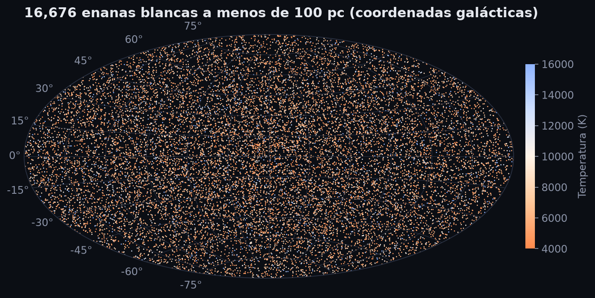

# Planets around white dwarfs: an open research notebook

We are searching public archival data for planets and planetary debris that transit white dwarfs, the Earth-sized
remnants of stars like the Sun. This repository is our open notebook: the reports, the per-object vetting records,
the literature checks and the corrections, published as we go. It is a citizen-science project run by
**Christian Jair (Kister Space)**, ORCID [0009-0006-4779-3708](https://orcid.org/0009-0006-4779-3708); nothing here has been peer reviewed.

**Website:** https://christianjair27.github.io/white-dwarf-planet-search/ ·
**Videos:** [youtube.com/@KisterSpace](https://www.youtube.com/@KisterSpace)

## A pulsating white dwarf, and who found it first

While searching TESS for pulsating white dwarfs we flagged **WD J203728.70+145353.15**, a helium-atmosphere white dwarf
at 88 pc that pulsates with periods of 334.85 s and 283.55 s, and used seven years of public ZTF data to show that the
white dwarf, not a neighbour 4″ away, is the pulsator. **Another group had identified this star independently and
earlier** in their own TESS search, and it will appear in their paper (in preparation); we recognise their priority and
will not submit our note separately. Our analysis stays public as an open record.
**[Preprint and data](papers/2026-wdj2037-dbv/)** · [vetting record](notes/vetting/WDJ203728.70+145353.15.md) ·
[search report](reports/2026-11-12-zzceti-search.md). Not yet peer reviewed.

## Why white dwarfs

A white dwarf has about half the Sun's mass packed into a body the size of the Earth. A planet crossing it blocks a
large fraction of the light, but only for minutes, so ordinary transit searches tuned for hour-long events miss it.
Only one planet is known to transit a white dwarf, WD 1856+534 b (Vanderburg et al. 2020, Nature 585, 363). Every
other planet that orbited these stars had to survive the star's red-giant phase; the ones we can find tell us what
happens to planetary systems, including ours, after their star dies.

## Data

- **Sample:** the 16,676 white dwarfs within 100 pc of the Gentile Fusillo et al. (2021) Gaia EDR3 catalogue
  (parallax > 10 mas, P_WD > 0.75); 3,339 are bright enough for TESS (G < 17).
- **Light curves:** NASA TESS SPOC products from MAST at 20-s and 120-s cadence. 2,847 of the 3,339 targets have
  20-s data ([census](data/tess_20s_coverage.csv), [report](reports/2026-10-21-search-status-report.md)).
- **Context:** Gaia, unWISE / Legacy Surveys, 2MASS / UKIDSS / VHS, SIMBAD and VizieR (Harvard mirrors), the NASA
  Exoplanet Archive.

## Method, in brief

1. **Stacked box least squares.** Each TESS sector is searched on one shared grid of 176,000 trial periods
   (0.15–13 d) with box durations of 1–30 minutes; the per-sector log-likelihoods are added, then the best period
   is refined on all sectors together. 20-s data are binned to 40 s.
2. **Thresholds:** SDE ≥ 10, depth S/N ≥ 8, at least three events.
3. **Automatic vetting:** physically possible duration for a white dwarf, odd/even depths, per-sector presence,
   proximity to data gaps, the TESS orbital alias (13.7 d and harmonics), contaminating flux from neighbours in the
   21-arcsecond pixel (CROWDSAP and Gaia DR3), SIMBAD and VSX.
4. **Validation:** the pipeline recovers WD 1856+534 b blind (P = 1.407939 d, SDE 51 with six 20-s sectors) and
   the debris transits of ZTF J0328-1219 (9.94 h).
5. **Sensitivity:** an injection-recovery test with exact uniform-disk transit models, injected into the raw light
   curves of real stars before cleaning and run through the full search.

## Status (12 November 2026)

| | |
|---|---|
| White dwarfs processed by the survey | 1,347 |
| searched, no signal above threshold | 1,192 |
| periodic signals from known objects (catalogued variables and binaries, and WD 1856+534 b itself) | 30 |
| periodic signals rejected as false positives | 42 |
| periodic signals still to vet | 16 |
| no usable TESS data / no TIC match / processing error | 58 / 3 / 6 |
| transiting planets or debris found | **0 so far** |

**Injection-recovery (final, 20 November 2026).** 304 injected bodies on 16 stars (G = 13.6–16.7), periods
0.2–10 d; 57.2 % recovered, none flagged at a wrong period, every non-grazing body of ≥ 1 Earth radius found
([report](reports/2026-11-20-injection-recovery.md), [research-note draft](papers/2026-injection-recovery/)):

| Injected radius (Earth radii) | Injections | Recovered |
|---|---|---|
| 0.1–0.3 | 75 | 11 % |
| 0.3–1 | 75 | 44 % |
| 1–3 | 74 | 78 % |
| 3–10 | 80 | 94 % |

| Gaia G | ≈ 13.5 | ≈ 14.5 | ≈ 15.5 | ≈ 16.5 |
|---|---|---|---|---|
| Radius recovered 50 % of the time (P = 1 d) | 0.26 | 0.41 | 0.67 | 1.08 Earth radii |

Across the 1,489 white dwarfs searched by 20 November, an Earth-sized transiting body (0.2–10 d) would have been
found with ≥ 50 % probability around 82 % of them, a Moon-sized one around 4.5 %.

## Reports

| Date | Report | Result in one line |
|---|---|---|
| 2026-10-21 | [Search status](reports/2026-10-21-search-status-report.md) | 24 periodic signals at 2 min, 0 transits; census of TESS 20-s data for the 100 pc sample |
| 2026-10-25 | [Injection-recovery with machine learning](reports/2026-10-25-ml-transit-recovery.md) | a single 6-h window needs a ~4 % transit for 50 % recovery; 20-s data double recall for 1–3 min transits |
| 2026-10-25 | [WD 1856+534 b: migration and travel](reports/2026-10-25-wd1856-migration-and-travel.md) | our secular + N-body runs reproduce the published Kozai-migration explanation |
| 2026-10-26 | [The death of the Sun](reports/2026-10-26-death-of-the-sun.md) | REBOUND mass-loss runs on the Solar System; Mars is the innermost survivor |
| 2026-10-28 | [A linear timeline of cosmic history](reports/2026-10-28-cosmic-timeline.md) | Planck 2018 + ICS chart mapped onto 600 s |
| 2026-10-25 | [Fourteen years of weather at Gale crater](reports/2026-10-25-mars-rems-weather.md) | the CO₂ condensation cycle in Curiosity's REMS feed, a calibration exercise |
| 2026-11-07 | [Infrared excess, second pass](reports/2026-11-07-ir-excess-second-pass.md) | 113 excess candidates; after per-object literature checks, four have no individual published study |
| 2026-11-08 | [Polluted white dwarfs and wide companions](reports/2026-11-08-polluted-wd-wide-binaries.md) | we confirm the published deficit of wide companions; corrected after reading the full papers |
| 2026-11-09 | [The fate of the known exoplanets](reports/2026-11-09-planet-fate.md) | 186 of 4,294 planets around future white dwarfs survive; none inside 1 au |
| 2026-11-09 | [Cooling ages and habitable-zone windows](reports/2026-11-09-wd-cooling-clock.md) | cooling clock for all 16,676 stars; the TESS search already covers the habitable zone |
| 2026-11-12 | [Pulsating white dwarfs in TESS](reports/2026-11-12-zzceti-search.md) | 1,421 stars searched: 86 known pulsators (two of our candidates turned out to be published), one DBV confirmed with ZTF (found earlier by another group, see above), one candidate left; a targeted ZTF test validated on 20 known pulsators |
| 2026-11-20 | [Injection-recovery: how small a body can we find?](reports/2026-11-20-injection-recovery.md) | 304 injected bodies: 50 % recovery at 0.26–1.08 Earth radii from G 13.5 to 16.5; an Earth would be found around 82 % of the searched stars, a Moon around 4.5 % ([note draft](papers/2026-injection-recovery/)) |

**Corrections and negative results are part of the record.** Two examples: our best infrared-excess candidate turned
out to be published (2011, 2020, 2026) and the report says so; a ratio we first attributed to Xu et al. (2026) was our
own derived number, corrected after reading the full paper.

## Notes

- [notes/](notes/): literature verification, TESS 20-s availability, TESS orbital systematics, infrared-excess
  passes and novelty checks, papers read in full, the 3-D clustering of the sample, where to look first, and our
  first images with a small remote telescope (MicroObservatory).
- [notes/vetting/](notes/vetting/): one record per white dwarf whose periodic signal we vetted, with the verdict
  and the reason.

Paths such as `wdplanets/...`, `data/...` or `output/...` inside the reports refer to our survey pipeline and
working files; the pipeline will be released as its own package.

## Tools we released

- [wdclock](https://github.com/ChristianJair27/wdclock): white-dwarf cooling ages and habitable-zone windows.
- [planetfate](https://github.com/ChristianJair27/planetfate): which planets survive the death of their star.
- [telemetry-anomaly](https://github.com/ChristianJair27/telemetry-anomaly): spacecraft telemetry anomaly detection
  on NASA SMAP/MSL data, a reproduction with honest scoring.

## What comes next

See [ROADMAP.md](ROADMAP.md): extend the injection-recovery test to more stars and to noisy, single-sector and
120-s-only targets, prepare for
Gaia DR4 (2 December 2026), package the pipeline, and follow up the infrared-excess candidates.

## Licence and citation

Text and figures: CC BY 4.0. Code snippets: MIT. See [LICENSE](LICENSE) and [CITATION.cff](CITATION.cff).
