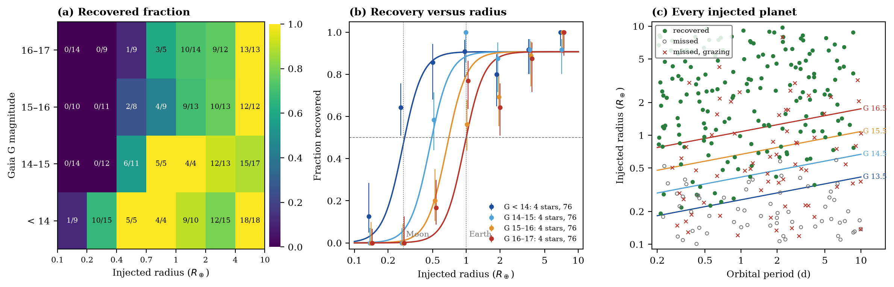

# How small a transiting body can TESS 20-s photometry detect around nearby white dwarfs?

**Preprint (draft, not peer reviewed):** [injection_preprint.pdf](injection_preprint.pdf) ·
LaTeX source for Research Notes of the AAS: [note.tex](note.tex), [note.bib](note.bib), [fig1.pdf](fig1.pdf)

**In one paragraph.** We added 304 synthetic transiting bodies (0.1–10 Earth radii, periods 0.2–10 d, exact
uniform-disk transit models, grazing orbits included) to the raw TESS 20-s light curves of 16 white dwarfs that our
survey had already searched, and ran the unmodified search and thresholds. 57 % were recovered at the right period and
none at a wrong one; every non-grazing body of one Earth radius or more was found. The radius recovered half of the
time at a 1-day period is 0.26, 0.41, 0.67 and 1.08 Earth radii at Gaia G ≈ 13.5, 14.5, 15.5 and 16.5. Applied to the
1,489 white dwarfs searched so far, an Earth-sized transiting body would have been found with at least 50 %
probability around 82 % of them, a Moon-sized one around only 4.5 %. Because transit probabilities are below 1 %, a
null result would limit Earth-sized bodies at 0.2–10 d to below roughly 30 % of white dwarfs (95 %), a forecast that
becomes a result only once the remaining periodic signals are vetted. The main limitation is the small number of test
stars (12).

**Full report** with all tables, the comparison with the K2 and TESS polluted-white-dwarf searches, and the
limitations: [reports/2026-11-20-injection-recovery.md](../../reports/2026-11-20-injection-recovery.md).

Comments and corrections are welcome through the repository's issues.

*Christian Jair (Kister Space), independent researcher, ORCID [0009-0006-4779-3708](https://orcid.org/0009-0006-4779-3708). First posted 2026-11-20.*
