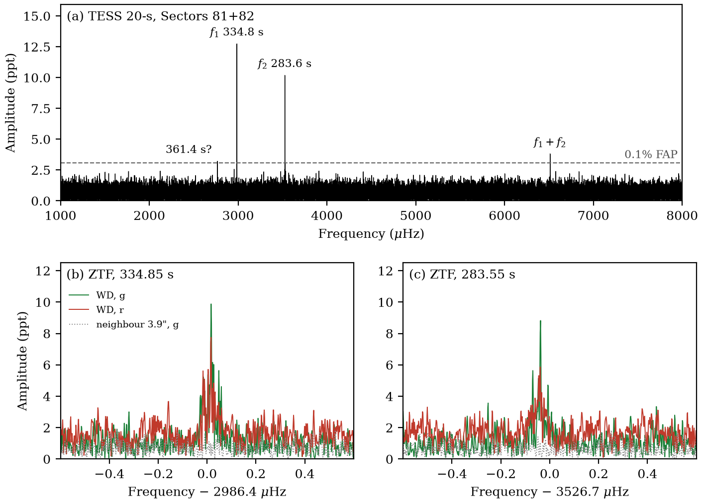

# WD J203728.70+145353.15: a pulsating DB white dwarf at 88 pc

> **Status (2026-11-24).** After this draft was posted we learned that another group had identified this star as a
> likely DBV independently and earlier, in their own TESS search, and is including it in a larger paper now in
> preparation. We recognise their priority and will not submit this note separately; the analysis below stays
> public as an open record.

**Preprint (draft, not peer reviewed):** [WDJ2037_DBV_preprint.pdf](WDJ2037_DBV_preprint.pdf) ·
LaTeX source for Research Notes of the AAS: [note.tex](note.tex), [note.bib](note.bib), [fig1.pdf](fig1.pdf)

**In one paragraph.** WD J203728.70+145353.15 (Gaia DR3 1810475401285228928, TIC 456645161) is a helium-atmosphere
(DB) white dwarf at 88 pc with Teff = 23,225 K (Kilic et al. 2020), inside the DBV instability strip. TESS 20-s data
from Sectors 55, 81 and 82 show two pulsation modes, 334.85 s and 283.55 s, and their sum frequency. The star shares
its TESS aperture with a background star 4″ away, so we searched seven years of public ZTF photometry at exactly those
two frequencies: both modes are there in g and r, and the neighbour, which ZTF resolves, is flat. The ZTF baseline
gives periods of 334.84948 ± 0.00008 s and 283.55430 ± 0.00007 s. A third mode at 361.40 s is possible (2024 only).
Gaia DR3 had flagged the star as variable without a period, and a blind ZTF search (Jestin et al. 2026) listed it as
not variable; we found no previous report of its pulsations (SIMBAD, ADS full text, VizieR; 2026-11-12).

**Records:** [vetting record](../../notes/vetting/WDJ203728.70+145353.15.md) (every test, including the literature
search and the corrections) · [ZZ Ceti / DBV search report](../../reports/2026-11-12-zzceti-search.md) (how the star
was found among 1,421 white dwarfs).

**The method that confirmed it** may be useful for other crowded TESS targets: a blind period search in sparse ZTF
data needs amplitudes of several percent, but fitting only within ±1 µHz of a frequency already known from TESS,
and calibrating the false-alarm level on 300 control frequencies, detects ~1 % pulsations.

Comments and corrections are welcome through the repository's issues.

*Christian Jair (Kister Space), independent researcher, ORCID [0009-0006-4779-3708](https://orcid.org/0009-0006-4779-3708). First posted 2026-11-13.*
