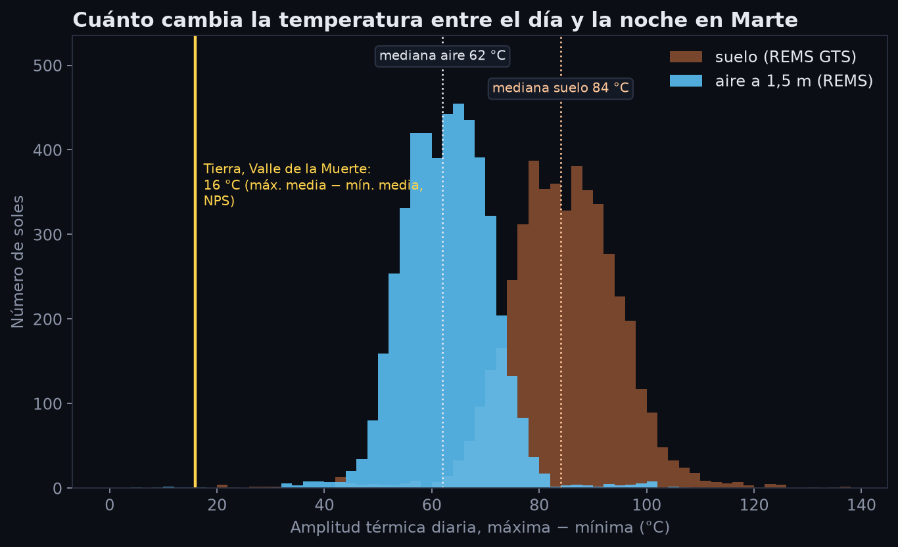
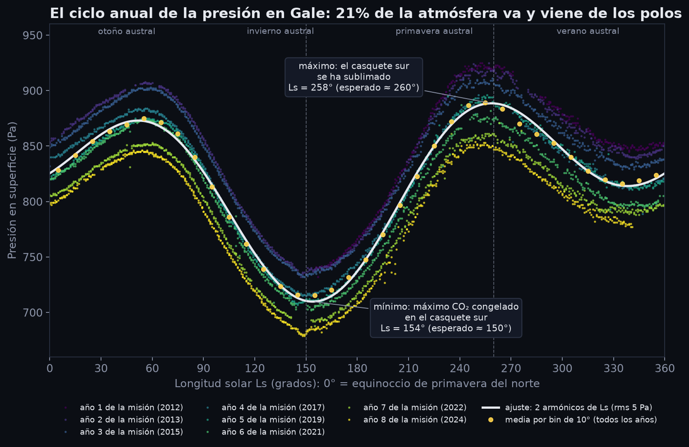
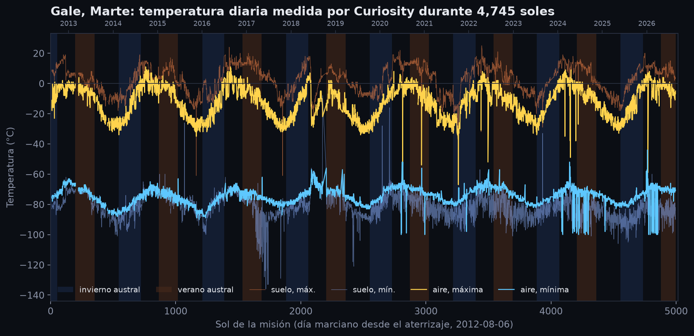

# Fourteen years of daily weather at Gale crater: the Curiosity REMS feed

*Lab report, 2026-10-25. Code: `wdplanets/labs/mars.py` (run `python -m wdplanets.labs.mars`). Outputs: `output/labs/mars/rems.csv`, `output/labs/mars/summary.json`, figures `../figures/mars_temperature.png`, `mars_pressure_cycle.png`, `mars_diurnal_range.png`.*

## Summary

We downloaded the public daily weather feed of the Rover Environmental Monitoring Station (REMS) on NASA's Curiosity rover, cleaned it into a tidy table of 4,745 sols (sol 1 to sol 4995, 2012-08-07 to 2026-08-25, 8 Mars years of the mission, 6 of them complete), and measured the basic climate of Gale crater. The air at 1.5 m averages -74.6 °C at night and -12.2 °C in the afternoon; the median day-night swing is 62 °C in the air and 84 °C on the ground, roughly four to five times the 16 °C of Death Valley. Surface pressure follows the solar longitude Ls with a peak-to-trough amplitude of 174 Pa (21 % of the 817 Pa mean): minimum at Ls 155° and maximum at Ls 255° in 10° bins, or Ls 154° and 258.5° from a two-harmonic least-squares fit (RMS 5.4 Pa, R² = 0.991). Both agree within 5° with the textbook CO₂ condensation cycle (minimum near Ls 150°, maximum near Ls 260°), so the data show the atmosphere freezing onto the southern polar cap every winter and returning every spring. The fit also finds a slow decline of -15.0 Pa per 1,000 sols between years, whose sign is consistent with the rover's climb up Mount Sharp but which we did not test against elevation.

## Data

* **Source.** The MSL weather feed served by NASA, produced by the Centro de Astrobiología (CAB, CSIC-INTA), the institution that built and operates REMS: `https://mars.nasa.gov/rss/api/?feed=weather&category=msl&feedtype=json`. A single request returned the whole mission (1.7 MB JSON); the raw file is cached at `data/labs/mars/rems_feed.json`. The feed's own disclaimer states it is intended for outreach, that REMS does not measure continuously and samples at different times from sol to sol, and that the rover itself (its heat, shade, orientation and dust) influences the readings; the calibrated science products live in the PDS. Because the feed already covers 2012-2026 we did not download the PDS REMS archive.
* **Content.** One record per sol with: sol number (sol 0 = landing day, 2012-08-06), terrestrial date, solar longitude Ls (integer degrees), season as "Month 1-12" (Ls/30°; the label matched floor(Ls/30)+1 on all 4,745 sols), minimum and maximum air temperature (°C, integer), minimum and maximum ground temperature (°C), pressure (Pa), a categorical UV index (Low / Moderate / High / Very_High), sunrise and sunset (local time), and an opacity flag that reads "Sunny" on 4,742 of 4,745 sols. Humidity and wind are "--" on every sol.
* **Coverage and gaps.** 4,745 of the 4,995 sols are present (250 sols absent from the feed, i.e. no record at all). Among the present sols the missing-value sentinel "--" appears 28 times for air temperature, 29 for ground temperature, 27 for pressure and 27 for UV.
* **REMS instrument.** The sensor suite (air and ground temperature sensors, pressure sensor, UV photodiodes, humidity and wind) is described in Gómez-Elvira et al. (2012).

## Method

1. **Cleaning.** "--" and empty strings become NaN; numeric columns are parsed; the UV label is kept and mapped to an ordinal 1-4; sunrise/sunset are converted to hours of daylight. Duplicate sols would be dropped (none were found).
2. **Derived columns.** Diurnal range = max - min for air and for ground. A *mission Mars year* counter starts at 1 on landing and increments each time Ls wraps from 359° to 0° (this is not the Clancy et al. Mars Year numbering, which we did not verify here). A southern-hemisphere season label is assigned from Ls (0-90° autumn, 90-180° winter, 180-270° spring, 270-360° summer; Gale is a few degrees south of the equator).
3. **Statistics.** Mean, median, standard deviation, 10th/90th percentiles and extremes of every variable; means per Mars month and per mission year.
4. **Pressure cycle.** All years folded on Ls in 10° bins; the bin with the lowest and highest mean pressure is compared with the expected Ls 150° and Ls 260° with a ±20° tolerance.
5. **Harmonic fit.** Ordinary least squares of p = a₀ + Σₖ₌₁² [aₖ cos(k·Ls) + bₖ sin(k·Ls)] + c·(sol - 2515.5)/1000 on the 4,718 sols with a pressure. The linear term in sol absorbs the slow inter-annual drift so that it does not leak into the seasonal harmonics. The seasonal curve is evaluated at the reference sol to locate its minimum and maximum.
6. **Earth reference.** For the diurnal-range comparison we use Death Valley (Furnace Creek): annual average high 33 °C minus annual average low 17 °C = 16 °C, from the US National Park Service "Weather and Climate" page (monthly values on the same page give 15-16 °C in every month). This is a difference of climatological means rather than a mean of daily ranges, which is the same construction we apply to a single sol, so the comparison is fair at the few-degree level.

## Results

**Temperature.** Air minimum: mean -74.6 °C (median -74, 10th-90th percentile -81 to -68). Air maximum: mean -12.2 °C (median -11, percentiles -27 to +1). Ground minimum: mean -81.5 °C; ground maximum: mean +2.6 °C. The warmest afternoon in the record is +11 °C (sol 760, 2014-09-25, Ls 202°); the warmest ground reading is +25 °C (sol 3446, 2022-04-16, Ls 209°). Single-sol extremes such as -100 °C air (sol 2803) and -136 °C ground (sol 1721) appear as isolated spikes in Figure (a) and are more likely sampling or sensor artefacts than weather; we do not use them as climate numbers.

**Seasons (Mars months, means over all years).** The coldest month is Month 3 (Ls 60-90°, southern winter and near aphelion): t_min -81.4 °C, t_max -27.2 °C. The warmest is Month 7 (Ls 180-210°, southern spring approaching perihelion): t_min -70.5 °C, t_max -2.5 °C. The seasonal swing in the afternoon maximum (25.1 °C between the warmest and coldest month) is about twice that of the night minimum (13.1 °C), as expected for a thin atmosphere whose night-time temperature is set mostly by radiative loss from the ground. Daylight varies only between 11.7 and 12.3 hours: Gale sits almost on the equator. The fraction of sols rated High or Very High UV ranges from 14 % in Month 3 to 72 % in Month 7. The per-month table is in `summary.json` (`by_season`).

**Diurnal range.** Air: mean 62.3 °C, median 62, 10th-90th percentile 53-72 °C. Ground: mean 84.1 °C, median 84, percentiles 72-96 °C. The Death Valley reference of 16 °C lies far to the left of both distributions (Figure c): a Martian day-night swing is roughly four times (air) to five times (ground) that of the hottest desert on Earth. The physics is the 7-9 hPa atmosphere: it stores little heat, transports little, and barely absorbs the ground's infrared, so the surface warms strongly under the Sun and cools equally fast after sunset.

**Annual pressure cycle.** Mean pressure 817.4 Pa (median 830, range 679-925 Pa). Folded on Ls in 10° bins the minimum is 715.3 Pa at Ls 155° and the maximum 889.0 Pa at Ls 255°: an amplitude of 173.7 Pa or 21.2 % of the mean. The two-harmonic fit gives a₀ = 818.4 Pa, first-harmonic amplitude 52.7 Pa, second-harmonic amplitude 56.4 Pa, RMS residual 5.4 Pa, R² = 0.9912, with the seasonal minimum at Ls 154.0° (709.7 Pa) and maximum at Ls 258.5° (888.5 Pa), fit amplitude 178.8 Pa. Both the binned and the fitted extrema fall within 5° of the expected Ls 150° / 260°, so the condensation cycle is detected clearly: during southern winter roughly a fifth of the column above Gale is frozen as CO₂ ice on the south polar cap, and it sublimates back by southern spring. The second harmonic being as strong as the first reflects the asymmetry between the two caps: the fitted curve has a secondary maximum of 873.0 Pa at Ls 51.5° and a secondary minimum of 814.0 Pa at Ls 338° (Figure b), the smaller cycle of the northern cap superposed on the southern one.

**Year over year.** Mean pressure of the complete mission years falls monotonically: 841.9 Pa (year 2, 2013-15), 840.4 (year 3), 817.5 (year 4), 816.9 (year 5), 808.6 (year 6), 796.6 (year 7, 2022-24). The fit's trend term is -15.0 Pa per 1,000 sols, about -75 Pa (9 %) over the mission. Curiosity has been driving uphill on Mount Sharp since 2014, and pressure falls with altitude, so the sign is what the climb predicts; we have not compared it with the rover's elevation record, and instrument drift cannot be excluded from these data alone. The temperature means show no comparable trend (yearly t_min means -72.6 to -77.2 °C, t_max -11.3 to -15.5 °C).

**Largest departures from the seasonal fit.** Negative residuals of -34.2 Pa (sol 2204, 2018-10-18), -29.7 Pa (sol 2333, 2019-02-28) and -25.5 Pa (sol 2347, 2019-03-14); positive residuals of +33.7 Pa (sol 2814, 2020-07-06) and +32.5 Pa (sol 2965, 2020-12-08). We have not attributed these to specific events.

## Limitations

* The feed is an outreach product, integer-rounded, from an instrument that samples intermittently; the sol-to-sol scatter and the isolated spikes partly reflect sampling times and rover influence, as the provider's disclaimer warns. Calibrated REMS products in the PDS would be needed for any scientific claim.
* 250 sols have no record and ~28 more have missing values; they are not interpolated.
* The UV index is a category in this feed, not an irradiance; humidity, wind and opacity carry no information here.
* The mission-year counter is relative to landing; conversion to the standard Mars Year numbering was not verified.
* The inter-annual pressure trend mixes rover altitude, instrument behaviour and any real climate signal; separating them needs the rover elevation history, which we did not download.
* The Earth comparison uses one station and climatological monthly means; deserts with larger diurnal swings exist, but the order-of-magnitude gap to Mars does not depend on the choice.

## Why this matters for a white-dwarf planet search

Mars is the only other planet whose atmosphere we can weigh every day, with a barometer on the ground: the 21 % annual breathing of its CO₂ measured here is the clearest example we have of a planetary atmosphere changing state with the seasons. Around white dwarfs we look for the same physics from much farther away. A transit depth is a measure of a planet's size against its star, just as the pressure amplitude is a measure of the mass of air moving to the poles; metal lines in a white dwarf's spectrum tell us the composition of the rocks it has swallowed, in the same way that REMS's sensors tell us what the air at Gale is made of and how it moves. Working through a dataset where the answer is known (the condensation cycle shows up exactly where the textbooks say) is the calibration we need before trusting a periodic dip in a TESS light curve that nobody has seen before.

## References

* Gómez-Elvira, J., et al. 2012, "REMS: The Environmental Sensor Suite for the Mars Science Laboratory Rover", *Space Science Reviews*, 170, 583-640.
* NASA / Centro de Astrobiología (CAB, CSIC-INTA), Mars Science Laboratory REMS weather feed, `https://mars.nasa.gov/rss/api/?feed=weather&category=msl&feedtype=json`, downloaded 2026-10-25 (cached in `data/labs/mars/rems_feed.json`).
* US National Park Service, Death Valley National Park, "Weather and Climate", `https://www.nps.gov/deva/learn/nature/weather-and-climate.htm`, read 2026-10-25.
* This project: `wdplanets/labs/mars.py`, `output/labs/mars/summary.json`.

## Figures

