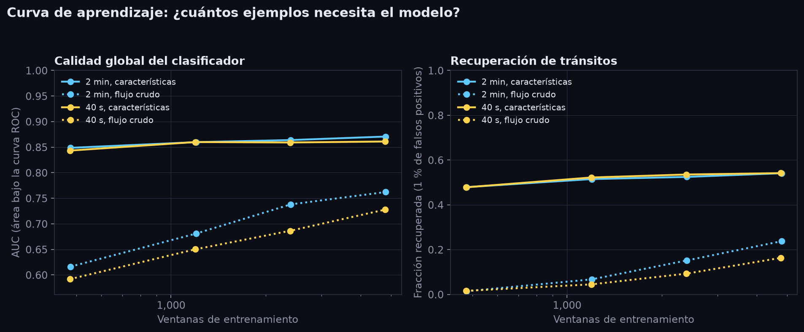
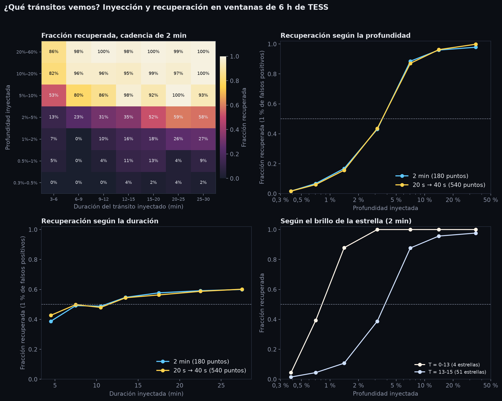

# Injection-recovery with machine learning: how shallow and how short a transit can we see in a TESS window?

As of 2026-10-25. Code: `wdplanets/labs/ml_transits.py`; numbers from `output/labs/ml/results.json` and `output/labs/ml/results_short.json`; dataset in `data/labs/ml/` and `output/labs/ml/windows_meta.csv`.

## Summary

We measured the sensitivity of a single-window transit detector on our own TESS data by injecting synthetic transits into real light curves of 55 white dwarfs and asking a classifier, trained on other stars, to find them. The experiment is the window-level counterpart of backlog item 6 (injection-recovery for the survey).

- Dataset: 6,000 windows of 6 hours at 2-min cadence (180 points) and their 5,970 twins at 20-s cadence binned to 40 s (540 points), cut from the same 121 sectors of the same 55 white dwarfs (TESS magnitude 11.3 to 14.9), with the same injected signal in both. Half the windows carry a trapezoid transit of depth 0.3 to 60 % and duration 3 to 30 min; the rest are untouched windows (20 %) or windows with an injected impostor: one-cadence dropout, linear ramp, or a 1-6 h sinusoid (10 % each).
- Model: 20 hand-crafted features (deepest 3-point-median dip, its width and asymmetry, a mini box search over 1 to 45 cells, slope, Fourier amplitude in the 1-6 h band, scatter, kurtosis, ...) into a gradient-boosted tree ensemble (scikit-learn `HistGradientBoostingClassifier`), evaluated with 5-fold cross-validation grouped by star. A 1-D convolutional network was not built: PyTorch is not installed in the project environment.
- Result at 2 min: AUC 0.871; at a false-positive rate of 1 % per window the recall is 54 % over the whole injected range, 17 % for depths of 1-2 %, 43 % for 2-5 %, 88 % for 5-10 % and 98 % for 20-60 %. Recall crosses 50 % at a depth of about 3.6 % (log-interpolated; the 5-10 % bin is the first one above 50 %). For the four stars brighter than T = 13 the crossing is near 0.8 %; for the 51 stars at T = 13-15 it is near 3.8 %.
- Duration matters less than depth: 39 % recall for 3-6 min transits against 60 % for 25-30 min, averaged over all depths. A 3-6 min transit deeper than 20 % is recovered 86 % of the time at 2 min; below 2 % nothing is recovered at any duration.
- 2 min versus 40 s: identical for 3-30 min transits (recall 54.1 % vs 54.2 % on the same windows; 50 % crossing at 3.6 % depth in both). The only hint of a gain is in the shortest bin (3-6 min: 39 % vs 43 %). A supplementary run with 1-3 min transits, the Earth-sized-planet regime, shows where the 20-s data pay: recall 16.5 % at 2 min against 31.9 % at 40 s, and the 50 % depth crossing moves from 30 % to 11 %.
- Training-set size: with 480 training windows the feature model already reaches 48 % recall and AUC 0.849; with 4,800 it reaches 54 % and 0.871. The same ensemble on the raw 180 flux values goes from 1.4 % to 24 % recall over the same range and is still climbing: explicit physics (features) buys an order of magnitude in data.
- Impostors: the hardest negatives are the untouched real windows (mean score 0.37; 29 % of them score above 0.5), then the single-cadence dropouts (0.25; 19 %), ramps (0.12; 8.5 %) and sinusoids (0.09; 7.4 %). Real TESS noise fools the model more than any synthetic impostor.
- Real planet: on 40 windows containing a transit of WD 1856+534 b in the 2-min PDCSAP data (sectors 14, 15, 19) the median score is 0.50 and 32.5 % pass the 1 % threshold; 40 control windows half an orbit away: median 0.14, none pass. In 20-s data (sectors 40, 79, 80) 62.5 % of transit windows pass (median 0.95), controls 2.5 %. The PDCSAP transit is 148 % deep with a per-point scatter of 39 % because only 2.9 % of the aperture light is the white dwarf (CROWDSAP), so a single transit has a signal-to-noise of only about 7 in a 6-h window.
- PG 1601+581: the sector-25 event that produced the 12.95-d survey signal scores 0.001; the model sees the ramp at the start of the sector (flux 0.83 recovering over 70 min), not a transit. Of the other five predicted events with data, four score 0.43-0.77 (below threshold) and one, at the sector-24 gap edge with 64 % data coverage, scores 0.93 (above threshold): the model was never trained on gap edges and is not immune to them.

## Data

All light curves are TESS SPOC products (Jenkins et al. 2016) already cached by the survey under `data/tess/mastDownload/TESS/` (MAST, doi:10.17909/t9-nmc8-f686): 1,529 2-min and 920 20-s light curves of 377 white dwarfs from the Gaia 100 pc sample. Only stars observed at both cadences in the same sector were used, so that the two datasets see the same sky on the same nights; WD 1856+534 (TIC 267574918) and PG 1601+581 (TIC 313424882) were excluded from training. A random choice of 55 such stars with up to three paired sectors each gave 121 sectors (sectors 29 to 107, TESS magnitude 11.3 to 14.9; 51 of the 55 stars are at T = 13-15).

Each light curve goes through the survey's own `transits.clean`: PDCSAP flux, normalised, flattened over 12 h, upward outliers clipped (cosmic rays), and the 20-s data binned to 40 s. Six-hour windows were cut on a fixed grid (180 cells of 2 min; 540 cells of 40 s), kept when at least 90 % of the cells had data, with the rest interpolated, and divided by their median. The 2-min sectors gave 10,100 raw windows; 6,000 were drawn at random. For each of them the 40-s window with the same start time was cut from the 20-s light curve of the same sector; 5,970 passed the coverage cut.

| Set | Windows | Points per window | Stars | Transits | Untouched | Dropout | Ramp | Sinusoid |
| --- | --- | --- | --- | --- | --- | --- | --- | --- |
| 2 min | 6,000 | 180 | 55 | 3,025 | 1,199 | 569 | 609 | 598 |
| 20 s binned to 40 s | 5,970 | 540 | 55 | 3,013 | 1,194 | 564 | 604 | 595 |

Injections (identical in the two cadences):

- Transit: trapezoid with depth log-uniform in 0.3-60 %, total duration uniform in 3-30 min, ingress and egress each 5-40 % of the duration, centre uniform inside the window, integrated over each exposure (a 3-min transit sampled every 2 min is mostly smearing, and the integration reproduces that).
- Dropout: one cell multiplied by 1 minus a depth drawn from the same 0.3-60 % range; the one-cadence glitches of `research/notes/tess_orbit_systematics.md`.
- Ramp: a linear drift of 0.3-10 % (either sign) over 0.5-3 h that then stays, as a PDC correction leaves after the 12-h flatten.
- Sinusoid: semi-amplitude 0.3-20 %, period 1-6 h, random phase, as a short-period binary or pulsator.

The arrays are in `data/labs/ml/windows_120s.npz` and `windows_20s.npz` (flux, label, features, star, kind); the per-window metadata (star, sector, start time, magnitude, kind, depth, duration, amplitude, period) in `output/labs/ml/windows_meta.csv`.

## Method

Features (20 per window, `ml_transits.features`): window minimum; depth, width and left-right asymmetry of the deepest dip in a 3-point running median; that dip's signal-to-noise against the window's robust scatter; the ratio of the raw minimum to the median-filtered minimum (large for a one-cell dropout); linear slope and the fraction of variance a line explains; the largest Fourier amplitude at periods of 1-6 h in units of the scatter, and its period; robust and plain scatter; kurtosis and skewness; fraction of points below 3 sigma; number of cells below half depth; depth of the second-deepest dip relative to the first (a periodic shape); and a mini box search: the best box signal-to-noise over widths of 1 to 45 cells, the winning width, and its ratio to the one-cell box (a dropout wins at one cell).

Models: scikit-learn `HistGradientBoostingClassifier` (300 iterations, learning rate 0.08, 31 leaves) on the features, and the same ensemble on the raw window values as a shape-agnostic baseline. Windows are split with `GroupKFold` (5 folds) on the star, so every test window comes from a star absent from training; all reported scores are out-of-fold. The operating point is the score threshold at which 1 % of all negatives (untouched plus impostors) pass; "recall" is the fraction of injected transits above that threshold. The learning curve refits the model inside each fold on a random 10, 25, 50 and 100 % of the training windows. Feature importance is by permutation (drop in AUC). The final model for the real windows is fitted on all 6,000 training windows. Run time of the whole script: 326 s on the 16-core machine.

The convolutional network foreseen in the plan was skipped: `import torch` fails in `.venv`, and the lab was not allowed to grow a new deep-learning dependency for this run.

## Results

1. Overall. 2-min feature model: AUC 0.871, average precision 0.893, threshold 0.917 at 1 % false positives, recall 54.1 %; at a plain 0.5 threshold recall is 70.9 % with 18.7 % of negatives passing. 40-s feature model: AUC 0.861, recall 54.2 %. Raw-flux models: AUC 0.762 and recall 23.8 % (2 min), AUC 0.728 and 16.3 % (40 s).

2. Recall versus depth and duration (2-min feature model, 1 % false positives; figure `ml_recall_map.png`):

| Depth | Transits | Recall |
| --- | --- | --- |
| 0.3-0.5 % | 296 | 2 % |
| 0.5-1 % | 414 | 7 % |
| 1-2 % | 416 | 17 % |
| 2-5 % | 511 | 43 % |
| 5-10 % | 391 | 88 % |
| 10-20 % | 397 | 96 % |
| 20-60 % | 600 | 98 % |

| Duration | Transits | Recall |
| --- | --- | --- |
| 3-6 min | 315 | 39 % |
| 6-9 min | 307 | 49 % |
| 9-12 min | 367 | 49 % |
| 12-15 min | 351 | 55 % |
| 15-20 min | 558 | 58 % |
| 20-25 min | 565 | 59 % |
| 25-30 min | 562 | 60 % |

The two-dimensional map shows where the limit sits: for 3-6 min transits recall is 53 % at 5-10 % depth and 86 % above 20 %; for 20-30 min transits it is 58-59 % already at 2-5 % and 93-100 % at 5-10 %. Below 2 % depth no duration reaches 30 %. The 50 % crossing, log-interpolated between bin centres, is at 3.6 % depth for all stars, 0.8 % for the four stars brighter than T = 13 (447 windows) and 3.8 % for the 51 stars at T = 13-15 (5,553 windows). At 40 s it is 3.6 % overall.

Detection limit of the survey, as seen from this experiment: in a single 6-hour window of a typical T = 13-15 white dwarf, a transit must be about 4 % deep to be recovered half the time, and about 8 % for 90 % (interpolating between the 88 % of the 5-10 % bin and the 96 % of the 10-20 % bin); for 3-6 min transits, which is the regime of an Earth-sized planet, about 7 % for 50 %. The survey has the advantage of periodicity, which this experiment does not use: stacking N transits lowers these limits by roughly the square root of N, and WD 1856+534 b (next item) is the worked example.

3. Real windows (final 2-min model, threshold 0.917):

| Windows | N | Median score | Above threshold | Above 0.5 |
| --- | --- | --- | --- | --- |
| WD 1856+534 b, transit, 2 min (sectors 14, 15, 19) | 40 | 0.50 | 32.5 % | 50 % |
| WD 1856+534 b, control, 2 min | 40 | 0.14 | 0 % | 10 % |
| WD 1856+534 b, transit, 20 s (sectors 40, 79, 80) | 40 | 0.95 | 62.5 % | 87.5 % |
| WD 1856+534 b, control, 20 s | 40 | 0.53 | 2.5 % | 55 % |

The PDCSAP transit of WD 1856+534 b is 148 % deep (median over windows) with a per-point robust scatter of 39 % at 2 min (63 % at 40 s), because SPOC divides by CROWDSAP = 0.029: only 2.9 % of the aperture light belongs to the white dwarf and the correction scales both signal and noise by 35. A single 8-min transit therefore has a signal-to-noise of about 7 in a window, and the model recovers one third of them at 2 min and two thirds at 20 s. The survey recovers the planet blind (SDE 51) only because it stacks about a hundred transits. The 2-min and 20-s windows come from different years (2019 versus 2021-2024) and sectors, so the difference between 32.5 % and 62.5 % mixes cadence with scattered-light and pointing differences; the paired injection test above says the cadence alone does not explain it for 3-30 min transits.

PG 1601+581 (the 12.95-d false positive of `research/notes/WDJ160241.98+575815.32.md`): of eleven predicted events in its six 2-min sectors, five fall in data gaps (sectors 15, 16, 23, 24 and the mid-sector gap of 25 at BTJD 1996.59). The six with data:

| Sector | Event (BTJD) | Data in window | Minimum flux | Score |
| --- | --- | --- | --- | --- |
| 15 | 1711.77 | 98 % | 0.971 | 0.77 |
| 22 | 1905.97 | 95 % | 0.972 | 0.55 |
| 22 | 1918.91 | 100 % | 0.969 | 0.43 |
| 23 | 1931.86 | 100 % | 0.965 | 0.73 |
| 24 | 1970.70 | 64 % | 0.947 | 0.93 |
| 25 | 1983.64 | 83 % | 0.825 | 0.001 |

The sector-25 event, the one the survey's box fit took for a 14 % transit with S/N 43, is the first 70 minutes of the sector, where the PDCSAP flux starts at 0.82 and climbs to 1.0: a ramp, scored 0.001. The verdict `false_positive` of the vetting note stands. The sector-24 window, which starts 1 h before a data gap and is padded by constant extrapolation on the other side, is the one false alarm (0.93): the model was trained only on windows with at least 90 % coverage and has never seen a gap edge, exactly the place where the vetting notes say the survey's spurious events live.

4. Supplementary run with 1-3 min transits (`results_short.json`: same stars, windows and seed, durations uniform in 1-3 min, four bins of 0.5 min; 3,025 transits at 2 min, 3,013 at 40 s). This is the regime of an Earth-sized planet crossing a white dwarf, and here the cadence does matter:

| Duration | Recall at 2 min | Recall at 40 s |
| --- | --- | --- |
| 1-1.5 min | 8 % | 22 % |
| 1.5-2 min | 12 % | 31 % |
| 2-2.5 min | 19 % | 35 % |
| 2.5-3 min | 26 % | 39 % |
| all 1-3 min | 16.5 % | 31.9 % |

| Depth | Recall at 2 min | Recall at 40 s |
| --- | --- | --- |
| 2-5 % | 3 % | 8 % |
| 5-10 % | 11 % | 30 % |
| 10-20 % | 28 % | 61 % |
| 20-60 % | 55 % | 91 % |

AUC 0.733 at 2 min against 0.777 at 40 s; the 50 % crossing moves from 30 % depth at 2 min to 11 % at 40 s. A 2.5-3 min transit deeper than 20 % is recovered 78 % of the time at 2 min and 99 % at 40 s; a 1-1.5 min one 28 % against 74 %. At 2-min cadence a transit shorter than the exposure is one low point, and the model cannot tell it from the one-cadence dropouts it was trained to reject: in this run the dropout is the worst impostor at 2 min (mean score 0.57, 65 % above 0.5) while at 40 s it drops to 0.42 and the untouched windows take over. This is the quantitative version of the survey's reason for moving to 20-s data (search version 2), measured on our own light curves: for 3-30 min transits the two cadences are equivalent, for 1-3 min ones the 20-s data roughly double the recall and nothing shallower than 10 % is reachable at 2 min.

5. Learning curve (figure `ml_learning_curve.png`):

| Training windows | Features, 2 min: AUC / recall | Raw flux, 2 min: AUC / recall | Features, 40 s: AUC / recall | Raw flux, 40 s: AUC / recall |
| --- | --- | --- | --- | --- |
| 480 | 0.849 / 47.9 % | 0.616 / 1.4 % | 0.843 / 47.8 % | 0.592 / 1.6 % |
| 1,200 | 0.860 / 51.5 % | 0.681 / 6.7 % | 0.860 / 52.2 % | 0.650 / 4.5 % |
| 2,400 | 0.864 / 52.5 % | 0.738 / 15.2 % | 0.859 / 53.5 % | 0.686 / 9.3 % |
| 4,800 | 0.871 / 54.1 % | 0.762 / 23.8 % | 0.861 / 54.2 % | 0.728 / 16.3 % |

The feature model is nearly flat after 1,200 windows; the raw-flux model is still rising at 4,800 and gets worse with 540 inputs than with 180. Permutation importance of the feature model: Fourier amplitude in the 1-6 h band (AUC drop 0.107), dip signal-to-noise (0.090), linear fit R² (0.039), best-box over one-cell box ratio (0.014), best-box S/N (0.013), second-dip ratio (0.012); the rest below 0.01.

6. Impostors (2-min feature model):

| Negative kind | N | Mean score | Above 1 % threshold | Above 0.5 |
| --- | --- | --- | --- | --- |
| Untouched real window | 1,199 | 0.371 | 0.9 % | 29.1 % |
| One-cadence dropout | 569 | 0.253 | 1.2 % | 19.3 % |
| Linear ramp | 609 | 0.117 | 1.0 % | 8.5 % |
| Sinusoid 1-6 h | 598 | 0.089 | 0.8 % | 7.4 % |

The threshold is global, so all kinds pass it at about 1 % by construction; the mean score and the 0.5 column rank them. Untouched real windows are the hardest: real TESS noise already contains dips, glitches and short drifts, and the training set gives any featureless window a prior of about one third of being a (shallow, invisible) positive. Dropouts come second because at 2-min cadence a 3-min transit and a one-cell glitch are the same thing; ramps and sinusoids are cleanly separated by the linear-fit and Fourier features. For the raw-flux model the dropout is the worst impostor (46 % above 0.5).

## Limitations

- Only 55 stars, 51 of them at T = 13-15; the bright-star curve rests on four stars and the sample has no star fainter than T = 14.9, while the survey goes to G = 17. The limits quoted are for T = 13-15.
- The injected transits are added after `clean` has flattened the light curve, so the small depth suppression the 12-h flatten causes on real 20-30 min transits is not modelled.
- Untouched windows are labelled negative, but a few stars in the sample are real variables (the survey's known binaries are among the cached light curves), so a fraction of "clean" negatives carry real signals; that makes the negative class harder, not easier.
- Windows need 90 % coverage; gap edges and sector starts, where the survey's false positives concentrate, are absent from training, and the PG 1601 sector-24 window shows the consequence.
- Single-window detection, no periodicity: the limits here are per transit, and the survey's stacked search is more sensitive by roughly the square root of the number of transits.
- No deep model: the CNN comparison, which is where the raw-flux learning curve was heading, is left for a run with PyTorch installed.
- The 40-s versus 2-min comparison is clean (same windows, same signals) but limited to 3-30 min durations in the main run; the 1-3 min case is the supplementary run with its own, smaller statistics.
- Seeds fixed (20261025); a different random draw of stars would move the recall numbers by a few percent (the 5,970-window paired set and the 6,000-window set differ by 0.1 % in recall, which gives the scale).

## References

- Christiansen, J. L., et al. 2015, ApJ 810, 95: Measuring Transit Signal Recovery in the Kepler Pipeline II (injection-recovery practice).
- Jenkins, J. M., et al. 2016, Proc. SPIE 9913, 99133E: The TESS Science Processing Operations Center (SPOC light curves, PDCSAP, CROWDSAP).
- MAST, TESS light curves: doi:10.17909/t9-nmc8-f686.
- Lightkurve Collaboration 2018, ascl:1812.013 (reading and flattening the light curves).
- Pedregosa, F., et al. 2011, JMLR 12, 2825: scikit-learn (HistGradientBoostingClassifier, GroupKFold, permutation importance).
- Ricker, G. R., et al. 2015, JATIS 1, 014003: the TESS mission.
- Vanderburg, A., et al. 2020, Nature 585, 363: WD 1856+534 b (period 1.4079 d, depth 56 %, duration 8 min).
- Project files: `wdplanets/transits.py` (`clean`), `research/notes/WDJ160241.98+575815.32.md`, `research/notes/tess_orbit_systematics.md`, `research/BACKLOG.md` item 6.

## Figures

