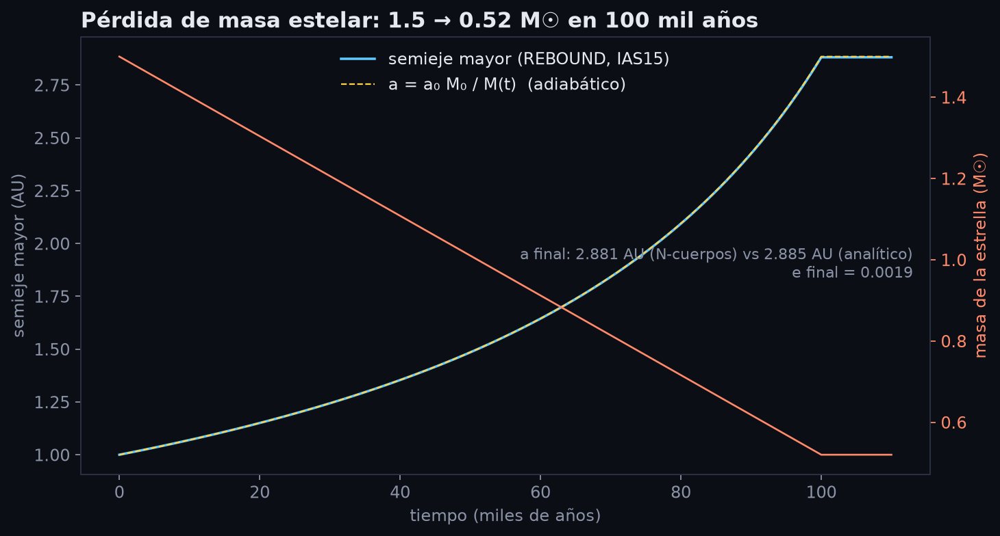
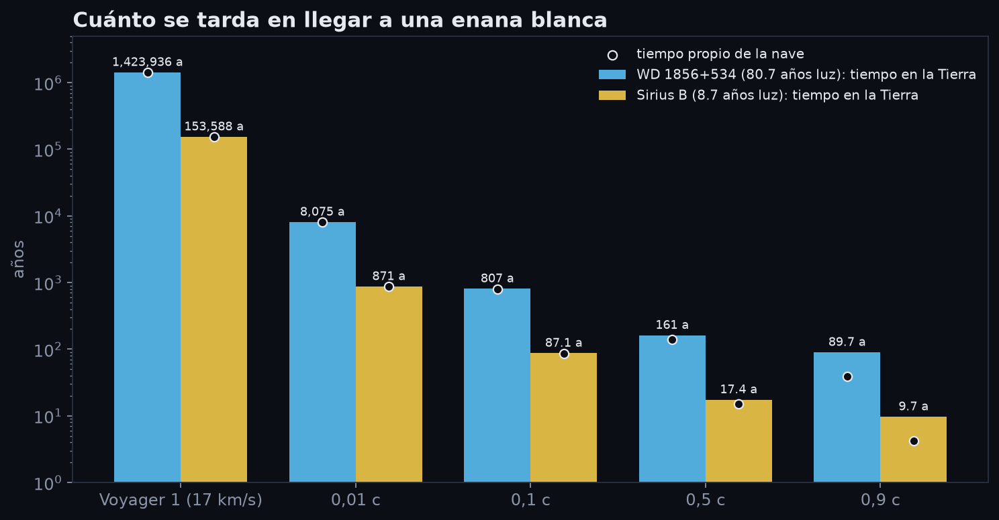
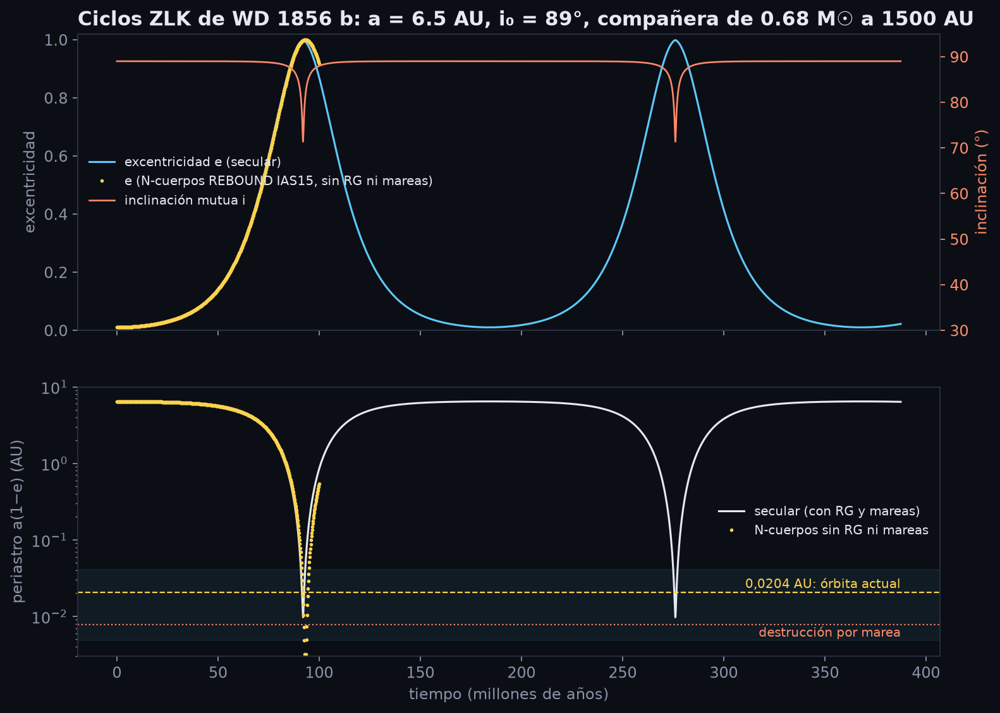
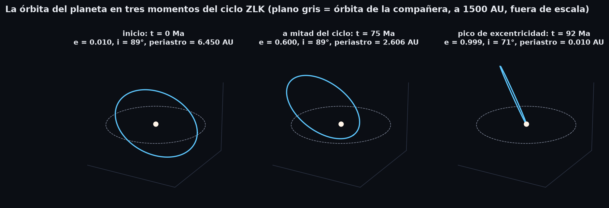

# WD 1856+534 b: how a giant planet ends up at 0.02 AU, and what it would take to go there

Date: 2026-10-25. Author: Kister Space (Christian Jair). Lab code: `wdplanets/labs/orbits.py` (survey pipeline,
not yet released); data: `output/labs/orbits/`.

## Summary

WD 1856+534 b orbits its white dwarf every 1.408 d at 0.0204 AU (Vanderburg et al. 2020), far
inside the radius the star reached as a red giant. We asked how it got there and
reproduced the published explanation with our own integrations:

1. **Mass loss widens orbits.** A planet at 1 AU around a 1.5 Msun star that loses mass slowly
   down to 0.52 Msun ends at 2.88 AU (REBOUND; analytic a·M = const gives 2.885 AU, N-body
   2.881 AU, 0.12 % lower). A planet born at ~2.25 AU is therefore at ~6.5 AU once the star is
   the 0.518 Msun white dwarf.
2. **The distant M-dwarf pair then drives von Zeipel-Lidov-Kozai (ZLK) cycles.** With G 229-20
   A/B (0.677 Msun combined) at 1500 AU, e = 0.3, and an initial mutual inclination of 89°, the
   planet's eccentricity rises to 0.9985 every 185 Myr while its semi-major axis stays at 6.5 AU.
   The periastron drops to 0.0097 AU (about 160 white-dwarf radii), above the tidal-disruption
   distance of 0.0078 AU.
3. **Tides finish the job.** Tidal dissipation in the planet near periastron conserves orbital
   angular momentum, so circularisation would leave the planet at a_f = a(1 − e_max²) = 0.0194 AU
   (period 1.37 d), against the observed 0.0204 AU (1.408 d). That floor is set by general
   relativity and the planetary tidal bulge, not by the exact inclination, which is why the
   observed orbit lets one infer the pre-migration orbit (Muñoz & Petrovich 2020).
4. The same planet at 2.25 AU around the 1.5 Msun progenitor would have been locked by
   relativistic precession (e_max = 0.48): mass loss is the switch that turns the mechanism on.

The travel calculator shows what 24.76 pc means: 1.42 million years at Voyager 1 speed; 90 years
of Earth time (39 on board) at 0.9 c, at a kinetic-energy cost of 1.2 × 10^17 J per kilogram,
so that about 5 tonnes of ship carry one year of world energy consumption.

## Data

All numbers in `output/labs/orbits/parameters.json` with their source. The ones that drive the
simulations:

| Quantity | Value | Source |
|---|---|---|
| White-dwarf mass | 0.518 ± 0.055 Msun | Vanderburg et al. 2020, Extended Data Table 1 |
| White-dwarf radius | 0.0131 ± 0.00054 Rsun | same |
| Cooling age | 5.85 ± 0.5 Gyr | same |
| Distance | 24.754 ± 0.044 pc (Gaia); catalogue 24.757 pc | same; `data/catalog/wd_100pc.csv` |
| Planet period | 1.4079405 ± 0.0000011 d | same |
| Planet semi-major axis | 0.0204 ± 0.0012 AU (e = 0 assumed) | same |
| Planet radius | 10.4 ± 1.0 Rearth | same |
| Planet mass | < 13.8 MJup (95 %, age < 10 Gyr); 0.7-3 MJup if it survived the RGB and migrated | Vanderburg et al. 2020; Muñoz & Petrovich 2020 |
| G 229-20 A, B masses | 0.346 ± 0.027, 0.331 ± 0.024 Msun | Vanderburg et al. 2020, Methods |
| A-B separation | 58 (+54/−16) AU; 2.3" on the sky | same |
| Outer orbit (WD to A/B barycentre) | a = 1500 (+700/−240) AU, e = 0.30 (+0.19/−0.10), periastron 1030 AU; 43" projected (~1000 AU) | same (LOFTI fit) |
| Progenitor mass | 1.5 Msun (survival + migration window 1.5-1.8 Msun) | Muñoz & Petrovich 2020, Sect. 3.2 |
| Main-sequence planet orbit | 2-2.5 AU, giving 5-8 AU after mass loss | Muñoz & Petrovich 2020 |
| Love number k2 | 0.37 | both migration papers |
| Voyager 1 speed | about 3.5 AU/yr (16.6 km/s); we use 17 km/s | NASA Science, Voyager FAQ |
| World energy use | 592 EJ in 2024 (sum of fuels) | Energy Institute Statistical Review 2025, via Wikipedia |

Adopted for the runs: M_WD = 0.518 Msun, planet 2 MJup and 10.4 Rearth, a_MS = 2.25 AU, so
a_WD = 2.25 × 1.5/0.518 = 6.52 AU; companion 0.677 Msun at 1500 AU, e = 0.3; initial e = 0.01,
initial mutual inclination 89° (a grid of 80-89.9° was also run).

The nearest white dwarf in our catalogue is WDJ064509.30-164300.72 at 2.670 pc, whose position
(RA 101.287°, Dec −16.721°) is that of Sirius B.

## Method

**A. Secular ZLK integration.** We integrate the quadrupole-order secular equations for the
planet's dimensionless angular-momentum vector j = √(1−e²) L̂ and eccentricity vector e in the
frame where z is the companion's orbital normal (O'Connor, Liu & Lai 2021, eqs. 1-2), with the
ZLK time-scale 1/t_LK = (m23/m0)(a1/a3,eff)³ n1, a3,eff = a3√(1−e3²) (their eq. 4). Two
short-range forces are added as a precession of e about L̂ (their eqs. 9-11): the
first-post-Newtonian term ω̇_1PN = 3Gm0 n1 / [c² a1 (1−e²)] and the tidal-bulge term
ω̇_tide = (15/2) k2 (m0/m1)(R1/a1)⁵ (1 + 3e²/2 + e⁴/8)/(1−e²)⁵ n1. The companion is one point
mass on a fixed orbit (test-particle limit; the planet is 0.4 % of the white-dwarf mass).
Integrator: SciPy DOP853, rtol 1e-10, atol 1e-13, 13 t_LK ≈ 390 Myr; output sampled at 120 000
points and downsampled to 3 000 rows along the (t, log(1−e)) curve for `zlk.json`. Without
short-range forces the code reproduces the textbook e_max = √(1 − 5/3 cos² i0) (checked:
0.99365 at 85°, matching the analytic value to the third decimal before the forces are switched
on). The same code with a = 2.25 AU, M = 1.5 Msun and the companion at 823 AU (its orbit also
expands with mass loss, a3 ∝ 1/(m0 + m23)) gives the main-sequence case.

**Direct N-body check.** REBOUND 5.2.2 (Rein & Liu 2012), IAS15 integrator (Rein & Spiegel
2015), three bodies (WD, planet, companion as one mass) with the same initial elements, run for
100 Myr, which covers the first eccentricity peak at 92 Myr; the companion's elements are
measured relative to the WD+planet barycentre. At 8 s per Myr this is the practical limit; a
full 390 Myr would take about an hour and the secular code gives the same physics in seconds.

**Tidal step (not simulated).** Tides raised on the planet at periastron dissipate orbital
energy but not angular momentum, so a_f(1 − e_f²) = a(1 − e_max²); for e_f → 0,
a_f = a(1 − e_max²) ≈ 2 q_min. Vanderburg et al. (2020) estimate about 2 Myr to circularise
from e ≈ 0.95 with Q/k ≈ 10⁵ for a Jupiter-mass planet (their eq. 12), after a chaotic-tide
phase of 1-100 Myr at higher e (Veras & Fuller 2019, as cited there). Tidal disruption happens
inside q_dis = 2.7 Rp (M_WD/Mp)^(1/3) (Muñoz & Petrovich 2020, eq. 10).

**B. Mass loss.** REBOUND IAS15, star 1.5 → 0.52 Msun linearly over 10⁵ yr with the stellar
mass updated every 1 yr (about one orbit), planet of 1 MJup at 1 AU, then 10⁴ yr at constant
mass. Compared with a = a0 M0/M(t).

**C. Travel.** Constant speed v = βc over distance d: Earth time t = d/v; ship proper time
τ = t√(1−β²); kinetic energy per unit mass K = (γ − 1)c², γ = 1/√(1−β²) (reduces to v²/2 at
Voyager speed). Energies are compared with 592 EJ.

## Results

**ZLK cycles (i0 = 89°).** t_LK = 29.8 Myr (Muñoz & Petrovich's eq. 1 gives 29.5 Myr for the
same a and mass). Peaks of e at 92.4 and 277 Myr: a ZLK cycle of 185 Myr, which fits comfortably
within the 5.85 Gyr cooling age (about 30 cycles). e_max = 0.99851 while the pure quadrupole
value for this inclination would be 0.99975: the short-range forces cap it. Minimum periastron
q_min = 0.0097 AU = 159 white-dwarf radii, above q_dis = 0.0078 AU, so the planet survives.
The inclination dips to 71° at the peak and recovers, as required by the conserved
(1 − e²) cos² i; a stays at 6.52 AU throughout.
Circularisation at the peak gives a_f = 0.0194 AU, period 1.37 d (observed 0.0204 AU, 1.408 d).

Inclination grid (same system):

| i0 | e_max | q_min (AU) | a_f = a(1−e_max²) (AU) |
|---|---|---|---|
| 80° | 0.9729 | 0.177 | 0.348 |
| 85° | 0.9927 | 0.047 | 0.094 |
| 87° | 0.9970 | 0.019 | 0.039 |
| 88° | 0.9981 | 0.012 | 0.024 |
| 89° | 0.9985 | 0.0097 | 0.0194 |
| 89.9° | 0.9986 | 0.0092 | 0.0183 |

Above ~88° the outcome no longer depends on i0: it is the short-range-force floor, and it lands
on the observed orbit. The window of inclinations that works is a few degrees wide, which
Muñoz & Petrovich (2020) widen to ~3° through octupole terms (εoct ≈ 1.1 × 10⁻³ (a/5 AU)) and
turn into a ~5 % migration fraction; O'Connor, Liu & Lai (2021) widen it much more (70-110°)
through the secular resonance of the 2+2 configuration, which needs a1 ≈ 30-60 AU and which our
point-mass companion cannot reproduce.

**Main-sequence check.** With the star at 1.5 Msun, the planet at 2.25 AU and the pair at
823 AU, the cycles are throttled by relativistic precession: e_max = 0.48, q never below
1.18 AU, t_LK = 41 Myr. Vanderburg et al. (2020) saw the same in Mercury6 runs with the planet
at 1-2 AU around the white dwarf (slow cycles, e ~ 0.1); the difference with the papers that
followed is the starting distance after mass loss.

**N-body cross-check.** The REBOUND run (30 min of CPU for 100 Myr, a conserved to 7 × 10⁻⁶)
follows the secular curve through the rise (e = 0.0187, 0.051, 0.140, 0.378 at 16.7, 33.3, 50
and 66.7 Myr) and peaks at 93.2 Myr, 1.2 Myr after the secular peak; after the peak the two
curves differ by up to 0.048 in e because of that shift. The peak itself is the instructive
part: REBOUND integrates Newtonian point masses only, so nothing caps the eccentricity, and the
N-body planet reaches e = 0.99971 (the pure quadrupole limit for 89° is 0.99975) and a
periastron of 0.0019 AU, inside the 0.0078 AU disruption distance. The direct integration thus
confirms the timing and amplitude of the secular model and shows that general relativity and
the planetary tidal bulge are what keep the periastron at 0.0097 AU instead of tearing the
planet apart (figure `lab_orbits_zlk_cycles.png`, gold points).

**Mass loss.** Final a = 2.8812 AU (N-body) vs 2.8846 AU (analytic), −0.12 %; final
e = 0.0019. The small offset comes from updating the mass in yearly steps rather than
continuously; the a(t) curve follows a0 M0/M(t) throughout (figure `lab_orbits_massloss.png`).
Scaling to WD 1856: 2.25 AU × 1.5/0.518 = 6.5 AU.

**Travel** (`travel.json`; WD 1856+534 at 24.757 pc = 80.75 ly, Sirius B at 2.670 pc = 8.71 ly):

| Speed | γ | WD 1856: Earth / ship (yr) | Sirius B: Earth / ship (yr) | K (J/kg) | K per kg ÷ world year |
|---|---|---|---|---|---|
| 17 km/s (Voyager 1) | 1.000000 | 1 423 900 / 1 423 900 | 153 590 / 153 590 | 1.4 × 10⁸ | 2.4 × 10⁻¹³ |
| 0.01 c | 1.00005 | 8 075 / 8 074 | 871 / 871 | 4.5 × 10¹² | 7.6 × 10⁻⁹ |
| 0.1 c | 1.00504 | 807 / 803 | 87.1 / 86.7 | 4.5 × 10¹⁴ | 7.7 × 10⁻⁷ |
| 0.5 c | 1.1547 | 161 / 140 | 17.4 / 15.1 | 1.4 × 10¹⁶ | 2.4 × 10⁻⁵ |
| 0.9 c | 2.2942 | 89.7 / 39.1 | 9.7 / 4.2 | 1.2 × 10¹⁷ | 2.0 × 10⁻⁴ |

Even at 0.9 c a one-tonne probe needs a fifth of a year of world energy production just as
kinetic energy, before propellant, deceleration or shielding.

Figures (dashboard gallery): `lab_orbits_zlk_cycles.png`, `lab_orbits_zlk_epochs.png`,
`lab_orbits_massloss.png`, `lab_orbits_travel.png`.

## Limitations

- Quadrupole-only secular model with the companion pair as a single point mass on a fixed
  orbit. No octupole terms (small here: εoct ≈ 1.4 × 10⁻³ at 6.5 AU), no back-reaction on the
  outer orbit, and none of the 2+2 inclination resonance of O'Connor et al. (2021).
- Tides are not integrated; a_f ≈ 2 q_min assumes angular-momentum-conserving circularisation and
  survival through the chaotic-tide phase, which O'Connor et al. (2021, Sect. 5.1) note disrupts
  most migrating planets in population syntheses.
- The initial inclination had to be within about 2° of 90° for our point-mass model; the
  likelihood of that configuration (a few per cent) is the subject of the two cited papers, not
  of this lab. The 0.0194 vs 0.0204 AU agreement depends on the adopted planet radius and mass
  through the tidal floor (1 − e_lim ∝ R1^(10/9) m1^(−2/9), O'Connor et al. eq. 14).
- The white-dwarf mass (0.518 ± 0.055 Msun) and the 1.5 Msun progenitor imply an age problem
  discussed by both Vanderburg et al. (2020) and O'Connor et al. (2021); we did not revisit it.
- The mass-loss run uses a linear mass-loss law and yearly mass updates; real AGB mass loss is
  episodic, and the −0.12 % offset in a is a numerical artefact of the stepping.
- Travel times assume instantaneous acceleration and no interaction with the interstellar
  medium; the energy comparison counts kinetic energy only.
- The REBOUND N-body check covers one peak, not the full 390 Myr run, and it has no
  short-range forces (REBOUNDx was not used), so it tests the Newtonian ZLK dynamics only.

## References

- Vanderburg A. et al. 2020, "A giant planet candidate transiting a white dwarf", Nature 585,
  363, arXiv:2009.07282 (system parameters, LOFTI orbit of G 229-20, tidal estimate).
- Muñoz D. J., Petrovich C. 2020, "Kozai migration naturally explains the white dwarf planet
  WD1856 b", ApJL 904, L3, arXiv:2010.04724 (ZLK time-scale, short-range-force limit,
  mass-loss switch, 2-2.5 AU main-sequence orbit, 0.7-3 MJup).
- O'Connor C. E., Liu B., Lai D. 2021, "Enhanced Lidov-Kozai migration and the formation of the
  transiting giant planet WD 1856+534 b", MNRAS 501, 507, arXiv:2010.04163 (secular equations,
  short-range forces, 2+2 resonance, a1 ≳ 8 AU limit).
- Rein H., Liu S.-F. 2012, A&A 537, A128 (REBOUND); Rein H., Spiegel D. S. 2015, MNRAS 446,
  1424 (IAS15).
- NASA Science, "Voyager: frequently asked questions" (3.5 AU/yr).
- Energy Institute, Statistical Review of World Energy 2025, 2024 totals by fuel as tabulated in
  Wikipedia, "World energy supply and consumption".
- Project data: `data/catalog/wd_100pc.csv` (Gaia EDR3 100 pc white dwarfs).

## Figures

