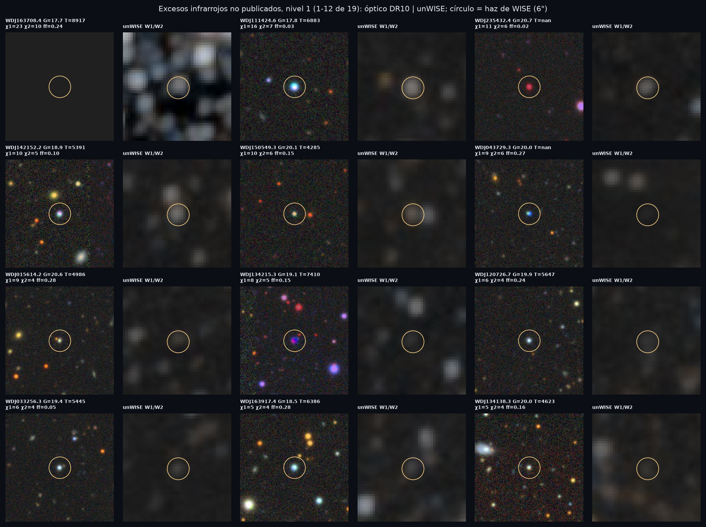
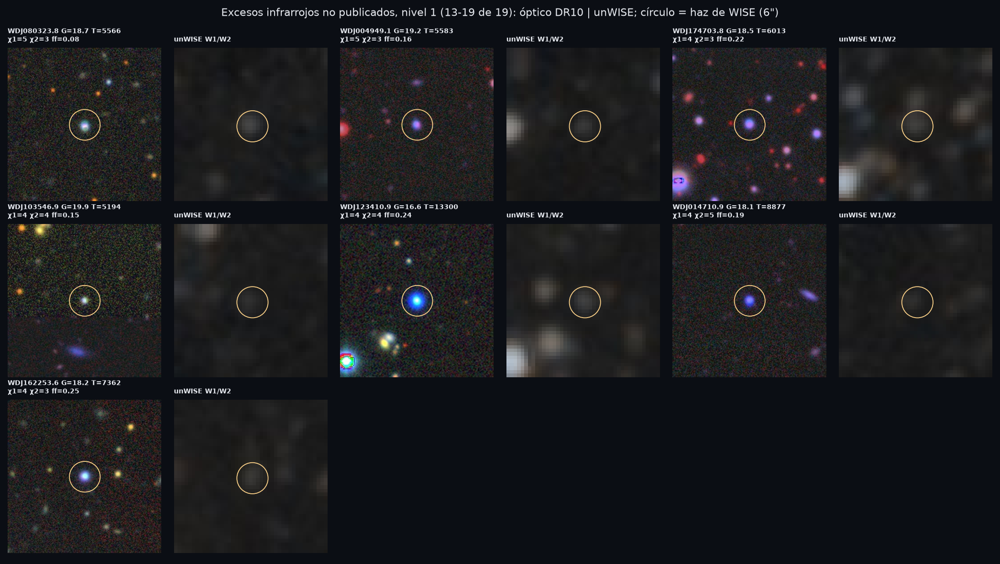

# Infrared excess around white dwarfs within 100 pc: second pass and new candidates

*2026-11-07 — Kister Space (Christian Jair). Read the 2026-11-08 correction below: one of the seven candidates was
already published, and per-object checks leave four without an individual study.*

## Summary

We re-ran our infrared-excess search on the Gaia 100 pc white-dwarf sample with two fixes (a saturation flag and a second
colour test in Gaia G), cross-matched the result with every published candidate list we could obtain, and vetted what was
left on images and in near-infrared catalogues. The method recovers 11 of the 12 Spitzer-confirmed excesses of Lai et al.
(2021) that fall in our clean set and 61-84 % of the WISE-based lists. Of our 113 candidates, 64 are already published and
49 are not; after rejecting crowded pixels, blends, a known DA+M binary and one misclassified red dwarf, **seven white
dwarfs with a 3-8 sigma excess at 3.4 and 4.6 µm that is not in the four lists we cross-matched remain**, all fainter than G = 16.6, i.e. in the part of the
sample the published surveys did not analyse. They are candidates for dust disks or substellar companions, not detections:
the literature loses about a third of such objects to follow-up, and ours sit near the WISE confusion limit.

In the same session the TESS transit survey's 18 open candidates were all closed (0 survivors), two of them with a new
deep-vetting tool; the per-object notes are in [notes/vetting/](../notes/vetting/).

## Data

- Our sample: 16,676 white dwarfs within 100 pc (Gentile Fusillo et al. 2021, VizieR J/MNRAS/508/3877; `wdplanets.catalog`).
- Legacy Surveys DR11 Tractor forced photometry (optical g/r/z and unWISE W1/W2) for 12,477 of them, through NOIRLab
  Astro Data Lab (`wdplanets.irx fetch`, 2026-10-29); 6,451 pass the cleanliness cuts (primary brick, no WISE mask,
  neighbours contribute less flux than the star, good PSF fit or very high S/N, W1 S/N > 5).
- Published excess lists, read on 2026-11-07 through the Harvard VizieR mirror (vizier.cfa.harvard.edu; the Strasbourg
  hosts have been unreachable from this machine since 2026-10-29): Xu, Lai & Dennihy 2020 (J/ApJ/902/127, tables 3-4);
  Madurga Favieres et al. 2024 (J/A+A/688/A168, tables 1 and 3); Murillo-Ojeda et al. 2026 (J/A+A/707/A268, 456
  objects). Lai et al. 2021 has no VizieR table: its machine-readable tables were taken from the arXiv source of
  2107.01221 (data/irx/lit/lai2021.csv, 328 rows; 62 confirmed excesses, "10 of which are likely to be stellar companions").
- Cutouts: Legacy Survey viewer (DR10 g/r/z, unWISE NEO7), 60" on a side. Near-IR: 2MASS PSC, VHS DR5, UKIDSS LAS at
  Data Lab. Gaia DR3 astrometric flags from the ESA archive TAP.

## Method

1. Empirical locus: in 0.05-mag bins of Gaia BP-RP, the running median and MAD scatter of z-W1 and z-W2 over the clean
   set define the colour of a bare white-dwarf photosphere; chi = (colour - median) / sqrt(sigma_int^2 + errors^2).
2. New: the same locus in G-W1 and G-W2, because DECam saturates near 16th magnitude and the z flux of bright stars is
   wrong (21 of the 128 first-pass candidates carried SATUR bits; LAWD 52 and CPD-69 177 were artefacts). A candidate must
   exceed 3 sigma in both colour systems (G only when saturated), with W2 S/N > 3.
3. Cross-match on position (5" plus ten years of proper motion) or Gaia id; a table's whole-sample rows (Xu table 3,
   Madurga table 3) count as "published" only when the table flags an excess.
4. Tier 1: not published, not saturated, neighbours add < 30 % of the W1 flux, W2 S/N > 5, SIMBAD type not a binary,
   galaxy or known variable (20 objects). Each was inspected on the DR10 / unWISE cutouts (the 6" circle is the WISE beam)
   and matched to 2MASS / VHS / UKIDSS within 3".

## Results

- 113 candidates (1.75 % of the clean set; 16 only through the G-based test because z is saturated).
- Recovery of published excesses in our clean set: Xu+ 2020 25/41 (61 %), Madurga+ 2024 previously-published 29/39 (74 %),
  Madurga+ 2024 CatWISE 32/38 (84 %), Murillo-Ojeda+ 2026 59/185 (32 %; their list includes J/H/K-only and tentative
  excesses that W1+W2 cannot see), **Lai+ 2021 Spitzer-confirmed 11/12 (92 %)**.
- 64 of the 113 are published, 49 are not. Tier-1 vetting of 20:

| WDJname | G | Teff (K) | d (pc) | chi(z-W1) / chi(z-W2) | neighbour flux in W1 | verdict |
|---|---|---|---|---|---|---|
| WDJ074231.99+285727.43 | 17.66 | 8,904 | 98 | 8.4 / 4.1 | 3 % | **candidate; UKIDSS J photospheric, K about 0.3 mag red** |
| WDJ123410.98+580815.53 | 16.60 | 13,300 | 99 | 4.4 / 4.3 | 24 % | candidate (2MASS K at the survey limit) |
| WDJ014710.96+301941.39 | 18.10 | 8,877 | 97 | 3.8 / 5.4 | 19 % | candidate; W2 excess stronger than W1 (disk-like colour) |
| WDJ033256.37-174323.78 | 19.42 | 5,445 | 94 | 5.7 / 3.6 | 5 % | candidate |
| WDJ080323.85+163357.90 | 18.65 | 5,566 | 64 | 4.8 / 3.1 | 8 % | candidate |
| WDJ163917.47+103604.84 | 18.52 | 6,386 | 74 | 5.2 / 3.7 | 28 % | candidate (magnetic DAH) |
| WDJ120726.77-075444.26 | 19.86 | 5,647 | 88 | 6.1 / 4.2 | 24 % | candidate; faint in unWISE, VHS J-Ks = 0.6 (red) |
| WDJ134138, WDJ004949, WDJ162253 | 18-20 | 4,600-7,400 | | 4-5 / 3-3.5 | | weak |
| WDJ043729.37-594603.40 | 19.98 | - | 69 | 9.2 / 5.9 | 27 % | marginal: nothing visible in unWISE, W2 S/N 5.6 |
| WDJ163708, WDJ174703 | | | | | | crowded fields, rejected |
| WDJ142152, WDJ150549, WDJ015614, WDJ134215 | | | | | | a second red source inside the WISE beam, rejected |
| WDJ103546.96-003145.62 | | | | | | edge of coverage, UKIDSS photospheric, rejected |
| WDJ235432.47+080404.64 | 20.74 | | | 10.6 / 5.7 | | not a white dwarf (UKIDSS G-J = 3.8, an M/L dwarf), rejected |
| WDJ111424.68+334124.39 | 17.77 | | | 16.0 / 7.4 | | known DA+M binary LP 264-22, the M dwarf is the excess |

The galleries are ../figures/irx_tier1_1.png and irx_tier1_2.png; the full table with notes is data/irx/tier1_new.csv.

## Correction 2026-11-08: the best candidate was already known

WDJ074231.99+285727.43 was flagged as an infrared-excess white dwarf by Girven et al. (2011; VizieR J/MNRAS/417/1210,
`ire` table, photometric companion type L6), followed up spectroscopically by Hogg et al. (2020; MNRAS 498, 12, who
suggest an M5-M6 companion and ask for radial-velocity follow-up) and re-listed by Wang et al. (2026; ApJ 1001, 81,
"WD + BD or dust disk candidates", marked as previously reported). Our four-list cross-match missed it; the
per-object SIMBAD bibliography check found it (research/notes/irx-novelty-2026-11-08.md). Girven et al. (2011) and
Wang et al. (2026) are now part of the cross-match: 65 of the 113 candidates are published, 48 are not; the method
recovers 3 of 3 Girven and 6 of 9 Wang excesses in our clean set. The candidates with no individual study found are
WDJ033256.37-174323.78, WDJ080323.85+163357.90 and WDJ163917.47+103604.84 (clean) and WDJ120726.77-075444.26
(marginal in the images). WDJ074231 remains in this report as a validation case: a known 19-sigma excess recovered
blind.

## Update 2026-11-08: light curves and SED fits

- unWISE epoch photometry (Legacy Survey DR11, 22-25 coadd epochs 2010-2024): WDJ074231 is stable; WDJ014710 and
  WDJ123410 have epochs where a neighbour steals the forced fit (per-epoch fracflux up to 7), so their mean excess is
  unreliable and they are downgraded to "uncertain". Five clean candidates remain: WDJ074231.99+285727.43,
  WDJ033256.37-174323.78, WDJ080323.85+163357.90, WDJ163917.47+103604.84, WDJ120726.77-075444.26.
- VOSA (SVO, Bayo et al. 2008; run on our account with our unWISE fluxes as user photometry and VO photometry
  from Gaia, SDSS, Pan-STARRS, 2MASS, UKIDSS, VHS, GALEX): VOSA's own excess detector flags 7 of the 11 objects,
  WDJ074231 as the only one with excess starting at W1. Chi-square fits with Koester DA models give temperatures within
  300 K of Gentile Fusillo et al. (2021) for nine objects. Against a blackbody photosphere at the fitted temperature,
  WDJ074231 (8,500 K, log g 7.5, chi2_red 15, 17 of 20 points fitted) shows 1.9x the photospheric flux at 3.4 um
  (22 sigma), 2.2x at 4.6 um and 1.2x in K, with J and H photospheric: the shape of warm dust or a brown-dwarf
  companion rather than an M dwarf. The 5,500 K objects show ratios of 2-3 but with poorer fits (chi2_red 30-45) and no
  VOSA flag. Table and caveats in research/notes/irx-second-pass.md; the blackbody approximation will be replaced by the
  Koester synthetic fluxes once the VOSA results archive is downloaded.

## Limitations

- These are photometric candidates. Murillo-Ojeda et al. 2026 removed about a third of their VOSA excesses on image
  inspection; Spitzer confirmed 79 % of the Xu et al. candidates it observed but only about a quarter of the colour-only
  ones (Lai et al. 2021). Our seven are 3-8 sigma objects with W2 S/N of 10-40.
- The locus is empirical, not a model atmosphere; cool (< 5,000 K) and helium-atmosphere white dwarfs can sit off it.
  Three of the seven are 5,400-5,600 K and deserve more suspicion than the 8,900-13,300 K ones.
- Only two of the seven have any near-IR photometry hinting at a K-band excess; the rest have none, so disk versus
  brown-dwarf companion cannot be separated yet.
- W1/W2 variability, model SED fits and Gaia non-single-star flags are still to do (research/notes/irx-second-pass.md).
- The Strasbourg CDS services are still unreachable from this machine; everything went through the Harvard mirrors,
  which lack hips2fits (so no survey astrophotos of these objects tonight).

## References

- Gentile Fusillo N. P. et al. 2021, MNRAS 508, 3877 (VizieR J/MNRAS/508/3877).
- Xu S., Lai S., Dennihy E. 2020, ApJ 902, 127 (VizieR J/ApJ/902/127).
- Lai S. et al. 2021, ApJ 920, 156 (arXiv:2107.01221, machine-readable tables in the source).
- Madurga Favieres C., Kissler-Patig M., Xu S., Bonsor A. 2024, A&A 688, A168 (VizieR J/A+A/688/A168).
- Murillo-Ojeda R., Jiménez-Esteban F. M., Rebassa-Mansergas A., Torres S. 2026, A&A 707, A268 (VizieR J/A+A/707/A268).
- Dey A. et al. 2019, AJ 157, 168 (Legacy Surveys); Schlafly E. F. et al. 2019, ApJS 240, 30 (unWISE).
- Noor H. T., Farihi J., Kenyon S. 2026, arXiv:2609.34868 (WISE variability of the 52 confirmed dusty WDs; read as the
  abstract only).
- Our files: research/notes/irx-first-pass.md, irx-second-pass.md, ir-excess-literature.md, irx-literature-2026-11-07.md.

## Figures

