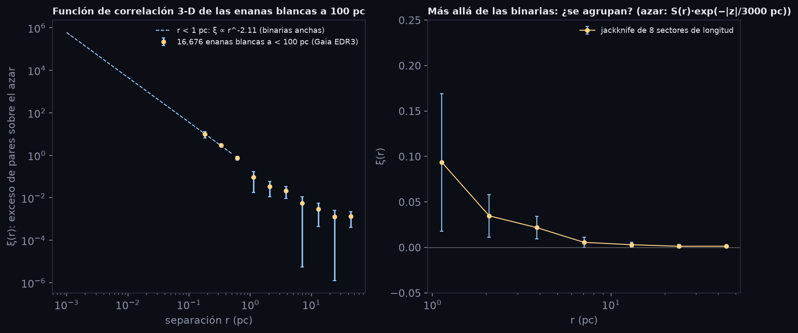

# Metal-polluted white dwarfs within 100 pc have half as many wide companions as the rest

Date: 2026-11-08. Author: Kister Space (Christian Jair). Status: a confirmation of published results; read the
correction of 2026-11-10 below.

## Summary

Cross-matching the Gaia EDR3 100 pc white-dwarf sample (16,676 stars) with the Gaia EDR3 wide-binary catalogue
of El-Badry, Rix & Heintz (2021), the 798 white dwarfs flagged as metal-polluted have a resolved companion
(100 to 10,000 au, chance-alignment probability below 10 %) in 6.5 ± 0.9 % of cases, against 12.0 % for
non-polluted white dwarfs matched in distance and apparent magnitude: 52 companions where 96 were expected,
a suppression factor of 0.54 ± 0.08. The deficit is the same for main-sequence and white-dwarf companions, at
100-1,000 au and at 1,000-10,000 au, and is present for the hydrogen-atmosphere polluted stars (11 vs 20.8
expected) as well as the rest (41 vs 75.2). The phenomenon is already published: Noor et al. (2024) find no
wide companions among 116 and 101 DZ stars (< 1.6 % and < 1.8 %, against 7-9 % for field white dwarfs), and Xu et
al. (2026, DESI DR1) find metals in 9.8 ± 2.1 % of white dwarfs in wide binaries against 20.5 ± 0.9 % of single
ones (4.7 sigma), and already split the result by companion type and by separation (100-1,000 / 1,000-10,000 au).
Our result is therefore a confirmation with a differently selected sample (pollution flags mostly from Gaia XP
spectra). The 2-sigma hint for hydrogen-atmosphere polluted stars goes AGAINST Noor et al. (2024), whose
UV-selected DAZ stars show no deficit (10.6 % companions); it is not a finding until the XP-only flags are tested
(see the correction below). A
three-dimensional two-point correlation function of the same sample, computed the same day, shows the
wide-binary tail to about 1 pc and no clustering beyond 7 pc.

## Data

- data/catalog/wd_100pc.csv: 16,676 white dwarfs with Pwd > 0.75 and parallax > 10 mas from Gentile Fusillo
  et al. (2021, VizieR J/MNRAS/508/3877), with Galactic x, y, z.
- data/polluted_priority.csv: 798 of them flagged as polluted on 2026-11-08 (logs/p20.py) from O'Brien et al.
  2024 (40 pc spectral types with Z), Coutu et al. 2019 (DZ), Hollands et al. 2017 (cool DZ) and Vincent et al.
  2024 (Gaia XP classes containing Z, or P(DZ) > 0.5; 595 of the 798 come only from this source).
- data/catalog/elbadry2021_100pc.csv: 25,099 pairs with Plx1 > 9.5 mas from El-Badry, Rix & Heintz 2021
  (VizieR J/MNRAS/506/2269, Harvard mirror), columns Source1/2, Plx, G, BP-RP, sepAU, theta, BinType, R.
- data/catalog/xp_classes.csv: Vincent et al. 2024 XP class and P(DZ) for every Gaia DR3 source in that
  catalogue; 14,008 of our non-polluted white dwarfs have a class.

## Method

`wdplanets/labs/wd_pairs.py --elbadry`. A white dwarf "has a companion" if its Gaia EDR3 source id appears as
either component of an El-Badry pair with R < 0.1. The control group is the non-polluted white dwarfs with an XP
class, re-weighted so that its joint histogram in distance (10 bins to 100 pc) and G (7 bins) equals the
polluted group's (effective control size 11,461 for the all-sample comparison). Companion fractions are
compared per projected-separation bin and per companion type (main sequence or white dwarf of our sample).
Errors on the polluted counts are Poisson; the control fraction's error is negligible by comparison.
`wdplanets/labs/wd_clustering.py` computes the Landy-Szalay correlation function of the full sample with
randoms drawn from the data's distance distribution and a fitted vertical gradient (best fit: none inside 100
pc), with an 8-wedge jackknife; `wd_pairs.py` (no flag) counts white-dwarf neighbours in 3-D separation bins.

## Results

| separation (au) | polluted with companion | expected (matched control) | ratio |
|---|---|---|---|
| < 100 | 1 | 1.9 | 0.5 |
| 100-1,000 | 27 | 51.2 | 0.53 |
| 1,000-10,000 | 23 | 38.7 | 0.59 |
| > 10,000 | 1 | 4.1 | 0.24 |
| all separations | 52 | 96.0 | 0.54 ± 0.08 |
| main-sequence companions | 43 | 70.9 | 0.61 |
| white-dwarf companions | 9 | 25.0 | 0.36 |
| H-atmosphere polluted (176 stars) | 11 | 20.8 | 0.53 |
| other polluted (622 stars) | 41 | 75.2 | 0.55 |

Using all non-polluted white dwarfs as the control instead of the XP-classified ones gives 96.3 expected: the
result does not depend on that choice. The 3-D white-dwarf-only neighbour counts (no external catalogue) agree:
0.0226 ± 0.0052 white-dwarf neighbours within 1 pc per polluted star against 0.0327 for the control, and 2
pairs at 0.003-0.3 pc where 6.5 were expected.

Correlation function of the full sample (data/catalog/xi_wd_all.csv, ../figures/wd_xi.png): ξ ∝ r^-2.1
between 0.1 and 1 pc; ξ = 0.094 ± 0.076, 0.035 ± 0.024, 0.022 ± 0.012 at 1.1, 2.1 and 3.8 pc; consistent with
zero from 7 pc outward (0.0013 ± 0.0009 at 44 pc).

## Physics, briefly

Metals in a white dwarf's atmosphere sink in days to millions of years, so pollution means ongoing accretion of
rocky debris, delivered when surviving planets perturb asteroids or comets onto star-grazing orbits. A wide
stellar companion was proposed as an extra perturber that would increase pollution (Bonsor & Veras 2015). The
data say the opposite: systems with a companion are polluted about half as often, which points to companions
having stripped or destabilised the reservoirs of small bodies (or the planets that stir them) during the
main-sequence and giant phases, leaving less material to accrete later.

## Limitations

1. The pollution flags are heterogeneous and the XP-based ones are noisy; contamination of the polluted group by
   non-polluted stars dilutes the deficit but cannot produce it.
2. A companion within about 3.5 arcsec (280 au at 80 pc) can blend Gaia's BP/RP spectra and hide the calcium
   feature from the XP classifier. This could contribute at 100-300 au but not at 1,000-10,000 au, where the
   deficit is as strong.
3. The El-Badry catalogue requires good astrometry for both components; this applies equally to both groups but
   removes some pairs, so the absolute fractions are lower limits.
4. The H-atmosphere split uses the spectral-type strings of whichever source catalogue listed the star; a proper
   DAZ/DZ comparison needs homogeneous spectroscopy, as in Noor et al. (2024).
5. (Superseded 2026-11-10: both papers have now been read in full; see the correction below and
   research/notes/pending-papers-read-2026-11-10.md.)

## Correction, 2026-11-10 (after reading the full papers)

- The first version of this summary attributed "suppression 0.48 ± 0.10" to Xu et al. (2026). That number is not
  in the paper. Xu et al. quote enrichment fractions of 9.8 ± 2.1 % (wide binaries) and 20.5 ± 0.9 % (single white
  dwarfs), 4.7 sigma apart (p. 4); 0.48 is our ratio of those two numbers, and it compares POLLUTION fractions, not
  COMPANION fractions as our 0.54 ± 0.08 does. The two are related but not the same quantity.
- Xu et al. (2026) already report the white-dwarf vs main-sequence companion split (6.6 ± 4.7 %, 2/30, vs
  10.3 ± 2.4 %, 19/185, p. 5) and discuss separation dependence (p. 6): those parts of our result are replications.
- Noor et al. (2024, p. 5) find DAZ white dwarfs in wide binaries at 10.6 (+3.9/-3.2) %, no deficit, in contrast to
  the DZ samples. Our hydrogen-atmosphere hint disagrees with that and is the only part that could be new.
- Decisive next check (not yet done): split the 595 polluted stars flagged only by Gaia XP classes from the 203
  with spectroscopic confirmation and repeat the comparison, including at large angular separations where XP
  blending cannot matter. If the deficit disappears in the XP-only group, the XP-based part of this result fails.
- **Done the same day** (`-m wdplanets.labs.wd_pairs --elbadry`, rows "XP-only" and "spectroscopic" in
  data/catalog/wd_pairs_elbadry.csv). Observed / expected wide companions against the matched XP-classified control
  (errors sqrt(n)/expected):

  | Polluted group | N | 100-1,000 au | 1,000-10,000 au | all separations | ratio |
  |---|---|---|---|---|---|
  | flagged only by Gaia XP (`xp_Z`) | 595 | 24 / 36.4 | 21 / 30.1 | 47 / 70.2 | 0.67 ± 0.10 |
  | confirmed by spectroscopy (any other source) | 203 | 3 / 14.8 | 2 / 8.6 | 5 / 25.7 | 0.19 ± 0.09 |
  | spectroscopic, hydrogen atmosphere (DA*) | 72 | 2 / 5.6 | 1 / 2.4 | 3 / 8.9 | 0.34 ± 0.19 |
  | XP-only, hydrogen atmosphere (DA*) | 104 | 3 / 6.2 | 4 / 5.1 | 8 / 11.9 | 0.67 ± 0.24 |

  Reading: the deficit is carried mostly by the spectroscopically confirmed polluted stars (5 companions where
  25.7 were expected), in line with Noor et al. (2024) and Xu et al. (2026). The XP-only group shows a weaker
  deficit, and it persists at 1,000-10,000 au (0.70 ± 0.15) where BP/RP blending by a companion cannot act, so
  it is not an artefact of blending. A weaker deficit is what a partly contaminated flag would give: if truly
  polluted stars had the spectroscopic ratio (0.19) and false flags the control ratio (1.0), the XP-only ratio
  implies that roughly 40 % of XP-only flags are real (our inference, assuming the two populations are otherwise
  alike). The hydrogen-atmosphere numbers (3 and 8 companions) are too small to support any statement on DA(Z)
  stars; note also that Noor et al.'s DAZ are hot and UV-selected, while ours are mostly cool 40 pc stars.
  Net effect on this report: what is solid is a confirmation of the published deficit; nothing here is new
  enough for a research note without a cleaner DA(Z) sample.
- Also to read before any statement on DA(Z) stars: Lizana-Vidal et al. 2026, arXiv:2607.22911 (named in Xu et al.;
  not yet read).

## References

- El-Badry, K., Rix, H.-W., Heintz, T. M. 2021, MNRAS 506, 2269 (VizieR J/MNRAS/506/2269).
- Gentile Fusillo, N. P., et al. 2021, MNRAS 508, 3877 (VizieR J/MNRAS/508/3877).
- Vincent, O., et al. 2024, A&A 682, A5 (VizieR J/A+A/682/A5).
- Noor, H. T., Farihi, J., Hollands, M., Toonen, S. 2024, "White Dwarf Pollution: One Star or Two?", MNRAS
  arXiv:2403.08870 (full text read 2026-11-10).
- Xu, S., Rogers, L. K., Najita, J., Gänsicke, B. T., et al. 2026, "Planetary Accretion Is Less Frequent in Wide
  Binaries: Evidence from Metal-Enriched White Dwarfs in DESI DR1", arXiv:2609.11798 (full text read 2026-11-10;
  journal status not stated in the PDF).
- Bonsor, A., Veras, D. 2015, MNRAS, arXiv:1508.05715 (abstract only).
- O'Brien, M. W., et al. 2024, MNRAS, arXiv:2312.02735 (used for the polluted list; abstract only).
- Project files: research/notes/wd-clustering.md, wdplanets/labs/wd_pairs.py, wdplanets/labs/wd_clustering.py.

## Figures

