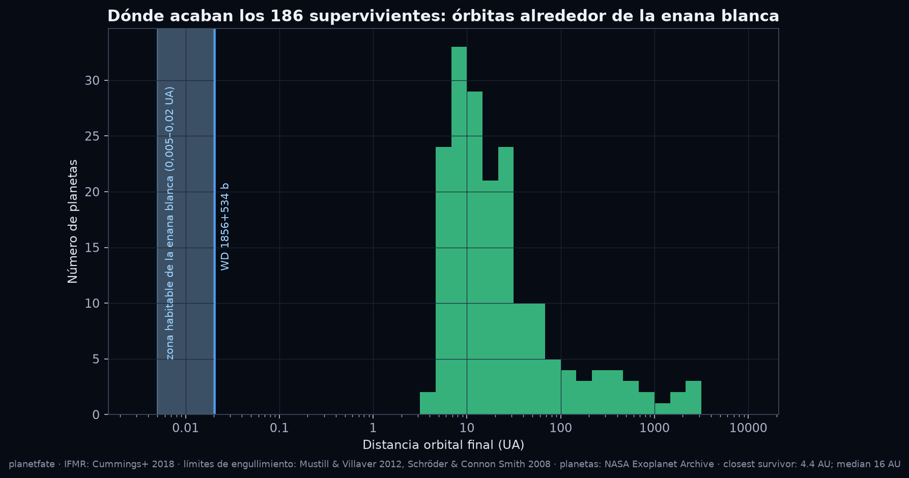
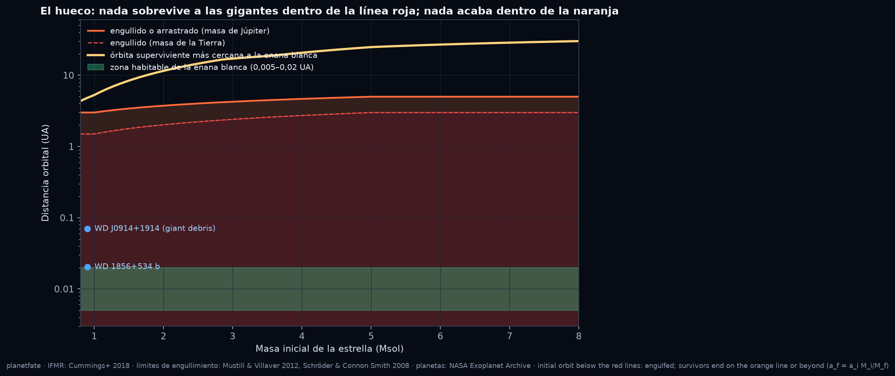
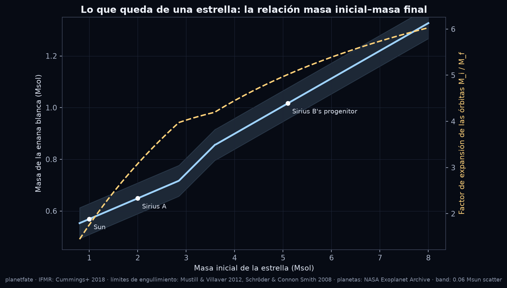
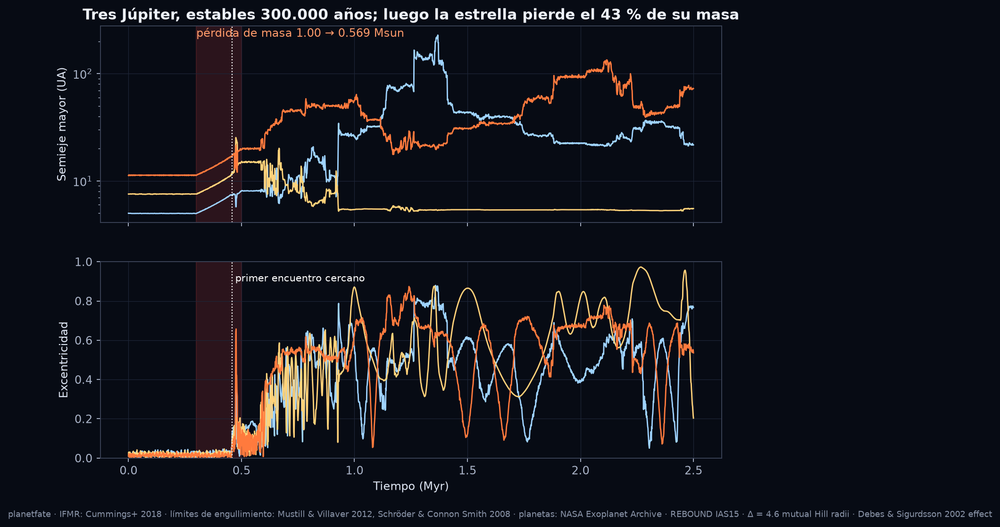
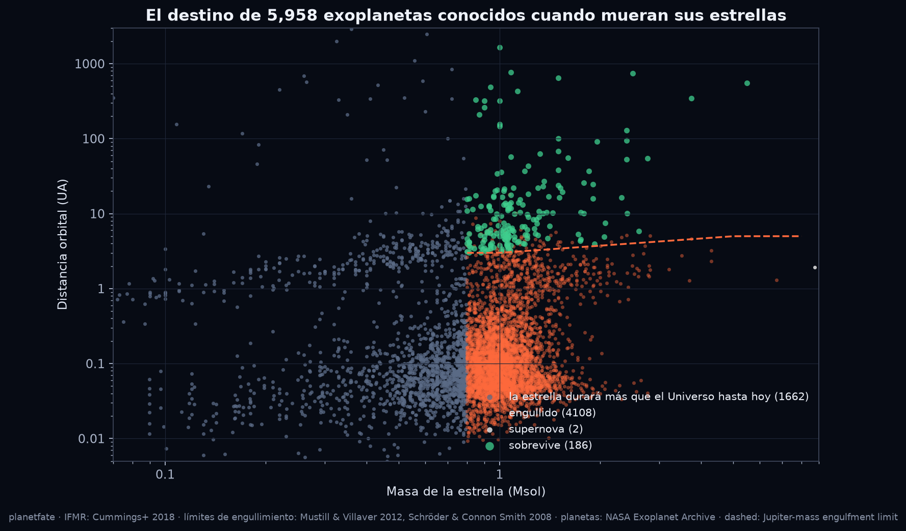

# The fate of the known exoplanets when their stars die, and why nothing survives close to a white dwarf

Report of 2026-11-09. Tool: [`planetfate`](https://github.com/ChristianJair27/planetfate) v0.1.0. Companion:
[wdclock report](2026-11-09-wd-cooling-clock.md).

## Summary

We encoded the published physics of what happens to a planet when its star becomes a white dwarf (initial-final
mass relation, engulfment and tidal capture on the giant branches, adiabatic orbit expansion) and applied it to the
6,464 planets of the NASA Exoplanet Archive. Of the 4,294 planets whose hosts will end as white dwarfs, 95.7 % are
engulfed; 186 survive, and the closest of them ends 4.4 AU from its white dwarf (median 16 AU, orbital periods of
decades). No survivor ends inside 1 AU, so the habitable zone of a white dwarf (0.01 AU) and the orbit of the
transiting planet WD 1856+534 b (0.02 AU) can only be reached by later migration. REBOUND N-body runs reproduce the
adiabatic expansion to 2 % and show the Debes & Sigurdsson (2002) mechanism that feeds migration and pollution: three
Jupiter-mass planets at 4.6 mutual Hill radii stay circular for 2.5 Myr at constant stellar mass, but when the star
loses 43 % of its mass the orbits cross within 0.16 Myr of the start of mass loss and one planet is thrown to a
pericentre of 0.14 AU. This replicates and updates Nordhaus & Spiegel (2013) with the 2026 census; it is not a
discovery.

## Data

- NASA Exoplanet Archive, Planetary Systems Composite Parameters (pscomppars), TAP sync query, 2026-11-09:
  6,464 rows; 5,958 with host mass and semi-major axis (data/catalog/exoplanets_pscomppars.csv).
- Published inputs: Cummings et al. 2018 IFMR (eqs. 4-6); Mustill & Villaver 2012 engulfment limits (abstract and
  Sec. 4); Schroeder & Connon Smith 2008 (Sun: 256 Rsun RGB tip, 0.546 Msun, Earth engulfed, 1.15 AU to survive);
  Debes & Sigurdsson 2002 (a_f = a_i M_i/M_f; Hill criterion); Nordhaus & Spiegel 2013 (gap edge 4-40 AU); Veras
  2016 (review). Villaver & Livio 2009 was not read (wrong arXiv id supplied to the fetch).

## Method

1. M_f = IFMR(M_i), Cummings et al. 2018 three-segment fit; hosts below 0.8 Msun are flagged "star still alive"
   (main-sequence lifetime longer than 13.8 Gyr), above 8 Msun "supernova".
2. a_crit(M_i, m_p): log-log interpolation between four anchors (Earth- and Jupiter-mass at 1 and 5 Msun: 1.5/3.0 and
   3.0/5.0 AU, Mustill & Villaver 2012); engulfed if the pericentre a(1-e) < a_crit.
3. Survivors: a_f = a_i M_i/M_f, e unchanged; period from Kepler's law with M_f.
4. N-body (REBOUND 5.2.2, IAS15, central mass updated every 5-10 yr): (a) eight-planet Solar System with a
   1.000 -> 0.569 Msun ramp over 200 kyr (adiabatic check); (b) three 1 M_Jup planets at 5 AU and Hill spacing Delta,
   300 kyr at constant mass, 200 kyr mass loss, 2 Myr after; control runs with constant mass for 2.5 Myr.
5. Tests: tests/test_planetfate.py (IFMR continuity and Sun, inverse, Earth/Jupiter fates, anchors, gap edge within
   4-40 AU, Hill spacing, N-body adiabatic check).

## Results

| quantity | value |
|---|---|
| planets with host mass and orbit | 5,958 |
| around stars below 0.8 Msun | 1,662 |
| around stars above 8 Msun | 2 |
| around future white dwarfs | 4,294 |
| engulfed | 4,108 (95.7 %) |
| survive | 186 (4.3 %) |
| closest survivor / median / median period | 4.45 AU / 16.4 AU / 88 yr |
| survivors inside 1 AU | 0 |
| survival by method | transit 0 %, RV 14 %, microlensing 65 %, imaging 98 % |
| closest surviving Jupiter by progenitor mass | 1: 5.3 AU · 2: 11.5 · 3: 17.1 · 5: 24.9 AU |
| N-body adiabatic check (1 AU, 1.5 -> 0.52 Msun) | a_f within 2 % of a_i M_i/M_f |
| instability, Delta = 4.6, control (constant mass, 2.5 Myr) | no encounter, e_max 0.04 |
| instability, Delta = 4.6, mass loss 1.00 -> 0.569 at 0.3-0.5 Myr | first encounter 0.458 Myr, e_max 0.97, pericentre 0.14 AU |
| instability, Delta = 5.5, mass loss | stable over 2 Myr (e_max 0.03) |

Figures: ../figures/planetfate_ifmr.png, planetfate_gap.png, planetfate_known_planets.png,
planetfate_final_orbits.png, planetfate_instability.png.

### Ensemble (Delta = 5.0, six seeds, 2.5 Myr each; output/labs/planetfate/instability_ensemble_d5.0.json)

Control (constant 1 Msun): 5 of 6 unstable within 2.5 Myr (Jupiter-mass triples at Delta = 5 are chaotic regardless).
Mass loss (1.00 -> 0.569 Msun from 0.3 to 0.5 Myr): 6 of 6 unstable; in 5 of 6 the first close encounter came
3,000-17,000 yr after the mass loss began; median minimum pericentre 0.26 AU against 1.0 AU for the controls. So the
robust statement is Debes & Sigurdsson's: mass loss sets the instability clock and deepens the plunges; the Delta = 4.6
pair shown in the video (control quiet for 2.5 Myr, loss unstable at 0.46 Myr) is one realisation, not a measurement.

## Limitations

- a_crit is a four-anchor interpolation; the cited papers differ by tens of per cent depending on the tidal
  prescription and AGB history, and planet masses between Earth and Jupiter are interpolated, not computed.
- IFMR scatter and host-mass errors are not propagated; the "still alive" flag is a mass cut, not an age.
- The instability run is one realisation at one spacing; Debes & Sigurdsson's result is statistical (timescales as a
  function of Delta and mu). Our runs illustrate it; they do not measure it.
- The composite-parameter table mixes heterogeneous sources.

## References

Cummings et al. 2018, ApJ 866, 21 · Debes & Sigurdsson 2002, ApJ 572, 556 · Mustill & Villaver 2012, ApJ 761, 121 ·
Nordhaus & Spiegel 2013, MNRAS 432, 500 · Rein & Liu 2012, A&A 537, A128 · Rein & Spiegel 2015, MNRAS 446, 1424 ·
Schroeder & Connon Smith 2008, MNRAS 386, 155 · Vanderburg et al. 2020, Nature 585, 363 (WD 1856+534 b) · Veras 2016,
RSOS 3, 150571 · Veras et al. 2011, MNRAS 417, 2104 · NASA Exoplanet Archive (Caltech/IPAC).

## Figures

