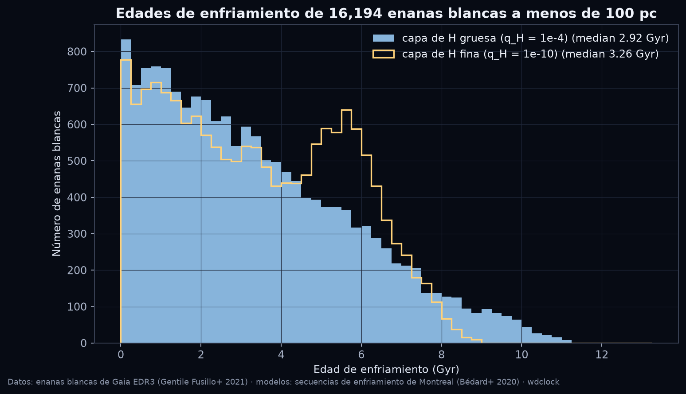
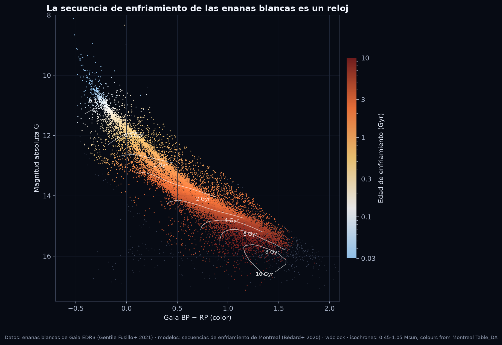
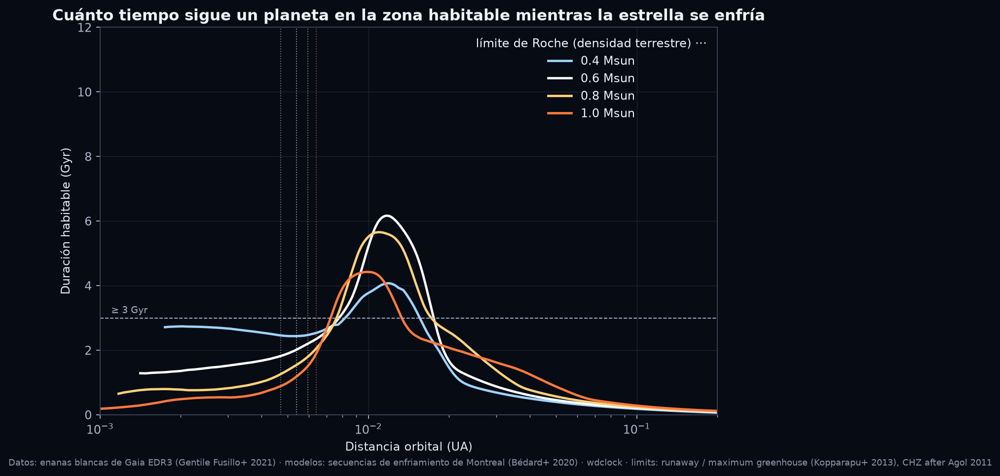
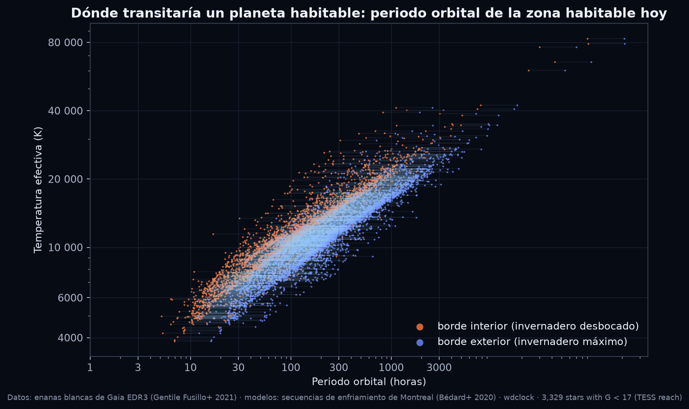
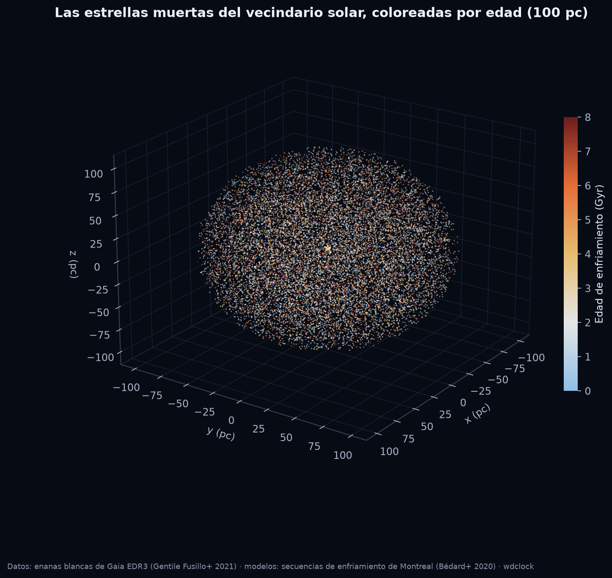
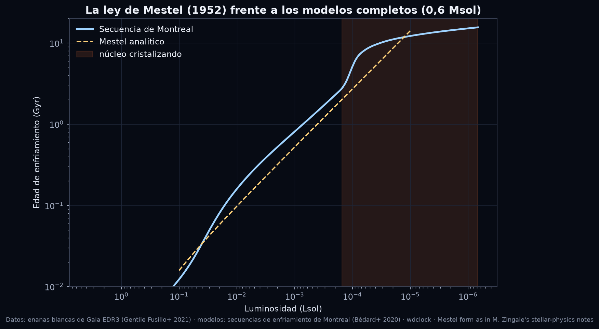

# Cooling ages and habitable-zone windows for the 16,676 white dwarfs within 100 pc

Report of 2026-11-09. Tool: [`wdclock`](https://github.com/ChristianJair27/wdclock) v0.1.0. Working note:
research/notes/wd-cooling-clock.md.

## Summary

We read the cooling clock of every white dwarf in our Gaia EDR3 100 pc sample with the Montreal evolutionary
sequences of Bédard et al. (2020) and computed, for each star, where its habitable zone lies today, how fast a planet
there would orbit, and for how long a planet at that orbit stays habitable as the star cools. The clock reproduces
the published cooling ages of Sirius B (127 vs ~126 Myr) and 40 Eridani B (106-117 vs ~122 Myr) and Agol's (2011)
continuously habitable zone. The sample's median cooling age is 2.9 Gyr, its oldest members 11.1-11.3 Gyr, and one
third of the stars have a core more than half crystallised. For the 3,339 stars within TESS reach (G < 17) the
habitable zone today has orbital periods of 100-230 hours (median range); 81 % of them have the whole zone inside
30 days, so our transit search already covers it. If every one of those stars hosted an Earth in its habitable
zone, geometry alone would show 7.5 of them in transit. This is a replication of standard methods on our own
sample plus a tool we had not found published for this catalogue; it is not a discovery.

## Data

- Gaia EDR3 white dwarf catalogue (Gentile Fusillo et al. 2021, VizieR J/MNRAS/508/3877), cut at parallax > 10 mas
  and P_WD > 0.75: 16,676 stars (data/catalog/wd_100pc.csv). Pure-hydrogen atmospheric parameters TeffH, loggH,
  MassH, fitted by the catalogue authors to G, BP, RP and the parallax with the Tremblay et al. (2011)
  atmospheres and the Bédard et al. (2020) mass-radius relation.
- Montreal evolutionary sequences (https://www.astro.umontreal.ca/~bergeron/CoolingModels/; downloaded 2026-11-09
  to data/models/montreal/): 23 masses from 0.20 to 1.30 Msun, C/O core, q_He = 1e-2, q_H = 1e-4 (thick) and
  1e-10 (thin); and the pure-H synthetic photometry Table_DA (Gaia DR3 bands, regular Teff x log g grid).
- Calibrators: Sirius B, Teff = 25,369 K, M = 1.018 Msun, cooling age ~126 Myr (Bond et al. 2017, ApJ 840, 70);
  40 Eri B, Teff ~17,200 K, M = 0.573 Msun (Mason et al. 2017), cooling age ~122 Myr (Bond et al. 2017b, ApJ 848, 16).

## Method

1. Along each mass track, log(age) is interpolated in log(Teff) (Teff decreases monotonically after the first
   1e5 yr); between the two bracketing masses the interpolation is linear. Luminosity, radius, log g and the
   crystallised fraction come from the same scheme. Masses outside 0.20-1.30 Msun give no age.
2. Habitable zone: flux limits of Kopparapu et al. (2013) for a Sun-like spectrum, runaway greenhouse
   S_in = 1.0512 and maximum greenhouse S_out = 0.3438 (solar constants), a = sqrt(L/S) AU. The temperature
   correction of Kopparapu et al. is valid only for 2600-7200 K and is not applied. Period from Kepler's law;
   Roche limit from Agol (2011); transit probability (R_wd + R_p)/a, duration P/pi x (R_wd + R_p)/a, depth
   (R_p/R_wd)^2 capped at 1, for an Earth-sized planet.
3. Habitable duration: along the star's own cooling track, the age at which L = S_in a^2 (entry) and L = S_out a^2
   (exit) for a planet at the current zone centre a = sqrt(a_in a_out). Agol's CHZ: the range of a with duration
   >= 3 Gyr.
4. Mestel (1952) analytic law in the form of M. Zingale's stellar-physics notes, for comparison.
5. Tests: tests/test_wdclock.py (8 tests: calibrators within 10-15 %, monotonicity, log g inversion, grid
   limits, Agol's CHZ numbers).

## Results

| quantity | value |
|---|---|
| stars with an age | 16,194 of 16,676 |
| median cooling age (thick / thin H) | 2.92 / 3.26 Gyr |
| 16th-84th percentile (thick) | 0.84-6.04 Gyr |
| oldest five | 11.1-11.3 Gyr (d = 62-83 pc, G = 20.1-20.9, Teff 3900-4200 K) |
| median within 40 pc (1,062 stars) | 2.78 Gyr |
| median hydrogen-layer systematic | 0.09 Gyr |
| core more than half crystallised | 33.7 % |
| habitable-zone periods today, all stars (median inner / outer) | 16 / 38 h |
| habitable-zone periods, G < 17 (3,339 stars) | 100 / 231 h |
| G < 17 stars with the whole zone inside P < 30 d | 81 % |
| habitable duration at the zone centre, median | 2.75 Gyr |
| stars with duration >= 3 Gyr | 7,686 (185 with G < 17) |
| geometric transit probability, median | 0.56 % |
| transiting habitable Earths if every G < 17 star had one | 7.5 |
| Agol CHZ, 0.6 Msun, >= 3 Gyr | 0.0078-0.0174 AU; longest stay 6.2 Gyr at 0.0117 AU |
| Mestel vs Montreal, 0.6 Msun | within a factor 1.5-2 from 0.1 to 1e-4 Lsun; stall by crystallisation below |

Figures: ../figures/wdclock_hr_isochrones.png (Gaia colour-magnitude diagram with 0.1-10 Gyr isochrones),
wdclock_age_histogram.png, wdclock_mestel_vs_montreal.png, wdclock_hz_periods.png, wdclock_hz_duration.png,
wdclock_map3d_age.png.

Comparison with the literature: the oldest cooling ages (11.1-11.3 Gyr) are consistent with the disc onset
derived from white dwarfs, 10.5 Gyr (Cukanovaite et al. 2023, 40 pc), ~10 Gyr (Tremblay et al. 2014, 20 pc) and
11.3 ± 0.5 Gyr (Fantin et al. 2019, CFIS), once progenitor lifetimes are ignored. The CHZ agrees with Agol (2011) in
range; the longest stay is shorter (6.2 vs 8 Gyr) with the 2020 sequences. The thin-layer bump at 5-6 Gyr in the
age histogram is a model feature (earlier crystallisation), not star formation.

## Limitations

- Pure-hydrogen parameters for every star; 20-25 % of white dwarfs have helium atmospheres (Fantin et al. 2019:
  21 ± 3 %), and their ages are biased. Gaia parameters are unreliable above 40,000 K, outside 0.2-1.3 Msun,
  for unresolved binaries and for contaminated photometry (Sirius B: the catalogue fit gives 0.34 Gyr; the
  true cooling age is 0.13 Gyr).
- The age distribution is that of a magnitude-limited sample: old, faint white dwarfs are missing beyond ~40-60 pc.
  Total ages need progenitor lifetimes (1-8 Gyr) added. No star-formation history is derived here.
- Habitable-zone limits are Solar-System-calibrated; UV photolysis by young white dwarfs (Barnes & Heller 2013;
  Kozakis et al. 2018), tidal effects and the delivery of a planet to 0.01 AU are not modelled.
- Habitable duration is computed for the planet now at the zone centre; a different orbit gives a different number
  (see wdclock_hz_duration.png).

## References

Agol 2011, ApJL 731, L31 · Barnes & Heller 2013, Astrobiology 13, 279 · Bédard, Bergeron, Brassard & Fontaine 2020,
ApJ 901, 93 · Bond et al. 2017, ApJ 840, 70 · Bond et al. 2017b, ApJ 848, 16 · Cukanovaite et al. 2023, MNRAS 522,
1643 · Fantin et al. 2019, ApJ 887, 148 · Gentile Fusillo et al. 2021, MNRAS 508, 3877 · Kopparapu et al. 2013, ApJ
765, 131 · Kozakis, Kaltenegger & Hoard 2018, ApJ 862, 69 · Mason et al. 2017, AJ 154, 200 · Mestel 1952, MNRAS 112,
583 · Tremblay et al. 2014, ApJ 791, 92 · Zingale, stellar-physics notes, https://zingale.github.io/stars/.

## Figures

