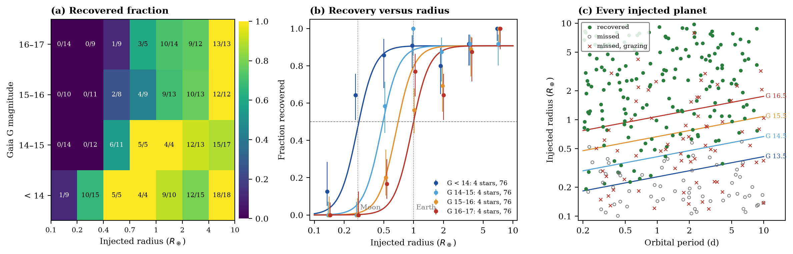

# How small a transiting body could our TESS white-dwarf search find? An injection-recovery test

Run 2026-11-11 to 2026-11-19, analysed 2026-11-20. Code: `wdplanets/inject.py`
(`run`, `analyse`, `plot`). Data products: `data/inject/injections.csv` (one row per injected planet),
`data/inject/stars.csv` (the frozen star list), `data/inject/analysis.json` (every number quoted below),
`data/inject/boot_stars.npy` (bootstrap fits), `data/inject/tmag.csv` (TIC magnitudes of the test stars),
`data/inject/targets_snapshot.csv` (frozen copy of the survey's target list, 2026-11-20, used for the sample estimates).

*Figure 1. (a) Recovered / injected planets in bins of injected radius and Gaia G magnitude. (b) Recovered fraction
versus radius in four magnitude bins (points with 68 % Wilson intervals, averaged over the injected periods) and the
fitted recovery model at P = 1 d and four TESS sectors (lines). (c) Every injected planet in the period-radius
plane; crosses are missed planets on grazing orbits; lines are the model's 50 % recovery radius for G = 13.5, 14.5,
15.5 and 16.5. Spanish version: [injection_recovery.png](../figures/injection_recovery.png). Research note draft: [papers/2026-injection-recovery](../papers/2026-injection-recovery/).*

## Summary

We added 304 synthetic transiting bodies (0.1–10 Earth radii, periods 0.2–10 d) to the real, raw TESS 20-s light
curves of 16 white dwarfs that our survey had already searched (12 test stars with 25 injections each, plus one
injection on each of 4 stars from an earlier trial), and ran exactly the survey's cleaning, stacked box-least-squares
search and detection thresholds. A body counts as recovered only if it would have been flagged as a candidate **and**
at the injected period (or a ×½, ×2, ×⅓, ×3 alias) within 0.2 %.

- **57.2 % (174/304) were recovered. All 174 flagged signals were at the correct period**; none was flagged at a
  wrong period.
- **Every non-grazing body of 1 Earth radius or more was recovered (65/65).** All 21 misses at R ≥ 1 R⊕ were
  grazing orbits that hid at most 19 % of the star.
- **Radius at which half the bodies are recovered** (model, P = 1 d, four sectors): **0.26 R⊕ at G ≈ 13.5,
  0.41 R⊕ at G ≈ 14.5, 0.67 R⊕ at G ≈ 15.5 and 1.08 R⊕ at G ≈ 16.5** (68 % star-bootstrap intervals in the table
  below). It grows by 0.21 dex per magnitude and by 0.21 dex per decade of period, and shrinks by 0.28 dex per decade
  in the number of sectors, close to what photon/background-limited box-search statistics predict.
- **Applied to the 1,489 white dwarfs the survey had searched by 2026-11-20:** an Earth-size body in a 0.2–10 d
  transiting orbit would have been found with ≥ 50 % probability around **82 % of them** (68 % interval 68–97 %), and
  on average with 69 % probability (60–82 %). For a **Moon-size** body (0.27 R⊕) the figures are **4.5 % of the
  stars** (3–8 %) and 8 % on average (6–12 %): the search sees Moon-size bodies only around the brightest stars.
- **What that buys, if no transiting Earth is among the 16 signals still to vet:** an effective sample (transit
  probability × completeness) of 7.5 stars for Earth-size bodies, i.e. a 95 % upper limit of ~30 % on the fraction of
  white dwarfs with an Earth-size body at 0.2–10 d. For 0.5 R⊕ the limit would be ~52 %, for the Moon ~80 %. These are
  forecasts of what the survey can say, not results yet.
- **Compared with published surveys:** for K2, van Sluijs & Van Eylen (2018) report that bodies above 0.5 R⊕
  (short cadence) or 1 R⊕ (long cadence) were recovered more often than not only at periods below 16 h; we reach
  0.5 R⊕ out to several days at G < 15. Robert et al. (2024), the TESS search of 313 polluted white dwarfs, show their
  sensitivity only as maps and quote occurrence limits (84 % for ~0.5 R⊕ at periods below a few days); our forecast
  limits are of the same kind but are not yet a measured result. The test uses only 12 stars, which is the dominant
  uncertainty.

## Data

- **Stars.** `pick_stars` drew stars from `research/targets.csv` with status `searched` (no signal above threshold),
  search version 2 (20-s data preferred), a TIC id and at least two TESS sectors, three per Gaia G bin
  (< 14, 14–15, 15–16, 16–17), seeded. The list is frozen in `data/inject/stars.csv`. Four stars from an earlier
  trial carry one injection each; they are kept (same procedure). The 16 stars span G = 13.60–16.72,
  TeffH = 4,900–34,800 K and Gaia masses 0.43–1.33 M☉ (radii 0.49–2.19 R⊕); all have 20-s data and 2–6 sectors.
  Their TIC magnitudes differ from Gaia G by −0.58 to +0.40 mag (median +0.09; cool stars brighter in T, hot
  stars fainter), so the G bins are within half a magnitude of TESS-magnitude bins.
- **Light curves.** NASA TESS SPOC PDCSAP light curves from MAST, the same products the survey uses: the newest
  six sectors, 20-s cadence when it exists (`transits.search_products`), NaNs removed and normalised but **not
  detrended** before injection.
- **Stellar parameters.** Mass and log g from the pure-hydrogen fits of the Gentile Fusillo et al. (2021) Gaia EDR3
  catalogue (our 100 pc extract, `data/catalog/wd_100pc.csv`).
- **Sample for the completeness estimates.** `research/targets.csv` on 2026-11-20 (snapshot saved): 1,560 rows, of
  which 1,489 have a completed search (1,392 `searched`, 49 `false_positive`, 32 `known`, 16 `candidate`); 67 have no
  TESS data, 3 no TIC match, 1 an error. G = 11.0–17.0; median four sectors; 177 stars have a single sector.

## Method

1. **The synthetic body.** White-dwarf radius R = √(GM/g) from the Gaia mass and log g; circular orbit with
   a from Kepler's third law; the light curve is the exact overlap area of two uniform disks (limb darkening ignored),
   so bodies larger than the star and grazing geometries are handled, averaged over each exposure by supersampling
   (`transit_model`). Radius drawn log-uniform in 0.1–10 R⊕, period log-uniform in 0.2–10 d (the survey grid is
   0.15–13 d), impact parameter uniform over every transiting orientation, 0 to 1 + Rp/R★ (so 51 % of the draws are
   grazing, b > |1 − Rp/R★|), phase uniform. The injected transit durations were 0.2–30 min (median 2.4 min; median
   2.0 min for 0.3–1 R⊕).
2. **The search.** The model multiplies the raw normalised flux; then exactly the survey's code runs:
   `transits.clean` (12-h flattening, upward-only clipping, 20-s data binned to 40 s) and `transits.search` (stacked
   BLS over all sectors, boxes of 1–30 min, 176,000 trial periods, refinement on all sectors).
3. **Recovery.** Flagged = survey thresholds (SDE ≥ 10, depth S/N ≥ 8, ≥ 3 events, positive depth;
   `survey.MIN_SDE`, `MIN_DEPTH_SNR`, `MIN_TRANSITS`). Recovered = flagged and found period within 0.2 % of the
   injected one or of ×½, ×2, ×⅓, ×3. The later vetting steps (odd/even, per-sector presence, crowding, literature)
   were not applied to the injections.
4. **Recovery model.** Maximum-likelihood fit to the 304 outcomes of
   p = A / (1 + exp[−(log₁₀R − μ)/s]), μ = μ₀ + c_G (G − 15) + c_P log₁₀(P/1 d) + c_N log₁₀ N_sectors.
   A < 1 is the ceiling set by grazing orbits. Nested models were compared by AIC: G only 209.6, G + P 199.4,
   G + P + N 198.1 (adopted). Uncertainties: 500 bootstrap refits resampling stars (the dominant term, quoted below)
   and 500 resampling injections. R50 is the radius where p = 0.5.
5. **Completeness of the searched sample.** For each of the 1,489 stars, the model completeness at its own G and
   sector count, averaged over a log-uniform period distribution in 0.2–10 d. The effective sample is
   N′ = Σ ⟨p_transit × completeness⟩ with p_transit = (R★ + Rp)/a from each star's Gaia mass and radius, and the 95 %
   upper limit for zero detections is f_max = 1 − 0.05^{1/(N′+1)}, as in van Sluijs & Van Eylen (2018, their eq. 7).

Expected scalings, for comparison with the fit. A box search's S/N grows as (Rp/R★)² √(N_in)/σ, where N_in, the
number of in-transit points, scales as (baseline/P) × duration and the duration as P^{1/3}. At a fixed S/N threshold
the detectable radius should therefore grow as P^{1/6} (0.17 dex per decade of period) and shrink as N_sectors^{−1/4}
(−0.25 dex per decade); per magnitude it should grow by 0.1 dex if the noise is photon-limited and by 0.2 dex if it is
sky/background-limited.

## Results

**Recovered fraction by radius and G** (Figure 1a). The "< 14" bin holds stars at G = 13.6–13.9.

| G | 0.1–0.2 R⊕ | 0.2–0.4 | 0.4–0.7 | 0.7–1 | 1–2 | 2–4 | 4–10 |
|---|---|---|---|---|---|---|---|
| < 14 | 1/9 (11 %) | 10/15 (67 %) | 5/5 (100 %) | 4/4 (100 %) | 9/10 (90 %) | 12/15 (80 %) | 18/18 (100 %) |
| 14–15 | 0/14 | 0/12 | 6/11 (55 %) | 5/5 (100 %) | 4/4 (100 %) | 12/13 (92 %) | 15/17 (88 %) |
| 15–16 | 0/10 | 0/11 | 2/8 (25 %) | 4/9 (44 %) | 9/13 (69 %) | 10/13 (77 %) | 12/12 (100 %) |
| 16–17 | 0/14 | 0/9 | 1/9 (11 %) | 3/5 (60 %) | 10/14 (71 %) | 9/12 (75 %) | 13/13 (100 %) |

All G together: 0.1–0.3 R⊕ 11 % (75 bodies), 0.3–1 R⊕ 44 % (75), 1–3 R⊕ 78 % (74), 3–10 R⊕ 94 % (80).

**Recovered fraction by period** (all G):

| Radius | 0.2–0.5 d | 0.5–1 d | 1–2 d | 2–5 d | 5–10 d |
|---|---|---|---|---|---|
| < 0.5 R⊕ | 6/30 (20 %) | 6/14 (43 %) | 2/20 (10 %) | 1/24 (4 %) | 0/19 (0 %) |
| 0.5–1 R⊕ | 8/12 (67 %) | 5/5 (100 %) | 4/8 (50 %) | 6/11 (55 %) | 3/7 (43 %) |
| ≥ 1 R⊕ | 37/38 (97 %) | 21/28 (75 %) | 25/25 (100 %) | 33/42 (79 %) | 17/21 (81 %) |

For bodies below 0.5 R⊕ recovery falls steadily with period (fewer transits); above 1 R⊕ the losses are the grazing
orbits, which occur at every period.

**Grazing geometry.** At R ≥ 1 R⊕, 65 of 65 non-grazing bodies and 68 of 89 grazing ones were recovered; every
miss was grazing and hid at most 19.4 % of the disk. Below 1 R⊕, 21 of 84 non-grazing bodies were recovered. The
fitted ceiling A = 0.91 (68 % interval 0.86–0.94) is this geometric loss.

**Fitted dependences** (adopted model, star bootstrap 16th–84th percentiles):

| Term | Fitted (dex) | Expected (dex) |
|---|---|---|
| per magnitude (G − 15) | +0.21 (0.16–0.26) | +0.1 (photon) to +0.2 (background-limited) |
| per decade of period | +0.21 (0.11–0.26) | +0.17 |
| per decade of sector count | −0.28 (−0.46 to −0.06) | −0.25 |

Width s = 0.09 dex: the transition from mostly missed to mostly found spans a factor of ~1.5 in radius.

**50 % recovery radius per magnitude bin** (P = 1 d, four sectors, the sample median):

| G bin (evaluated at) | Stars, injections | R50, model | 68 % (stars) | 68 % (injections) | Direct per-bin fit |
|---|---|---|---|---|---|
| < 14 (13.5) | 4, 76 | 0.26 R⊕ | 0.21–0.31 | 0.23–0.30 | 0.23 |
| 14–15 (14.5) | 4, 76 | 0.41 R⊕ | 0.34–0.48 | 0.36–0.47 | 0.53 |
| 15–16 (15.5) | 4, 76 | 0.67 R⊕ | 0.52–0.80 | 0.55–0.76 | 0.87 |
| 16–17 (16.5) | 4, 76 | 1.08 R⊕ | 0.76–1.42 | 0.82–1.29 | 0.82 |

The direct per-bin fit (centre free, width and ceiling fixed, periods averaged over the injected distribution)
agrees with the model within the star-to-star scatter. At G = 15 the model R50 rises from 0.38 R⊕ at 0.2 d to
0.53 R⊕ at 1 d and 0.85 R⊕ at 10 d. The Moon (0.27 R⊕) is at the 50 % level only around stars brighter than
G ≈ 13.6; the Earth only around stars brighter than G ≈ 16.3 at 1 d.

**Per-star scatter.** With the same draw distribution, the 12 test stars recovered between 36 % and 80 % of their
25 bodies (mean 57 %). The lowest were the faintest stars or those with only two sectors (WDJ051015.20−031724.14,
G = 16.7, two sectors: 36 %; WDJ175554.31−245648.94, G = 14.9, two sectors: 40 %).

## What this means for the 1,489 white dwarfs searched so far

| Body | Stars with ≥ 50 % completeness | Mean completeness | N′ (transit prob. × completeness) | f_max (95 %) if none found |
|---|---|---|---|---|
| Moon, 0.27 R⊕ | 4.5 % (3.0–7.7 %) | 8 % (6–12 %) | 0.84 | 80 % |
| 0.5 R⊕ | 20 % (16–39 %) | 29 % (23–39 %) | 3.0 | 52 % |
| Earth, 1 R⊕ | 82 % (68–97 %) | 69 % (60–82 %) | 7.5 | 30 % |
| 2 R⊕ | 99 % (97–100 %) | 88 % (83–89 %) | 12.3 | 20 % |

All for periods log-uniform in 0.2–10 d; at exactly 1 d the Earth-size fraction is 87 %. By brightness, the mean
Earth-size completeness is 0.90 (130 stars with G < 14), 0.86 (318, G 14–15), 0.66 (880, G 15–16) and 0.30 (161,
G 16–17); for the Moon 0.52, 0.12, 0.02 and 0.002. The median transit probability of an Earth-size body at 1 d is
0.62 %, which is why even 1,489 stars give an effective sample of only 7.5: **a null result would still allow up to
~30 % of white dwarfs to have an Earth-size body at 0.2–10 d**. The search is most sensitive in the brightest
30 % of the sample (G < 15), where it reaches roughly half an Earth radius; most of the sample (59 %) is at
G = 15–16, where it reaches about two thirds of an Earth radius.

These f_max values assume that none of the 16 signals still to vet is a transiting Earth-size body, and they inherit
every limitation below; they are a forecast of the survey's reach, not a published limit.

## Comparison with published white-dwarf transit-survey sensitivities

Only papers we read in full are used here.

- **K2: van Sluijs & Van Eylen (2018).** 1,148 white dwarfs from K2 Campaigns 1–13, all at 30-min cadence and 309
  also at 1-min cadence. Injections of Mandel–Agol transits into the raw photometry before systematics correction,
  0.125–16 R⊕ and 1 h–40 d in 35 tiles, one white dwarf of 0.6 M☉ and 0.012 R☉ assumed for all, recovered when the
  right period or a harmonic was found (Sect. 3.3). Their Sect. 4.2: at long cadence bodies larger than 1 R⊕ "for
  periods < 16 h are more often recovered than not", at short cadence the same holds for bodies larger than 0.5 R⊕.
  Their abstract gives 95 % limits of < 1.5 % for hot Jupiters and < 28 % for Earth-sized planets in the habitable
  zone (P = 4–32 d, their Fig. 4). Our test reaches 0.5 R⊕ at G < 15 out to several days (R50 = 0.41 R⊕ at 1 d for
  G = 14.5, 0.67 R⊕ at 10 d), i.e. more sensitive per star at the periods we cover. Our forecast f_max for Earth-size
  bodies (30 %, 0.2–10 d) is similar to their habitable-zone limit, from a comparable number of stars; the period
  ranges differ, so the two numbers are not directly comparable.
- **TESS, polluted white dwarfs: Robert et al. (2024).** 313 polluted white dwarfs, TESS 120-s and 20-s data
  (Sectors 1–65), BLS from 1 h to 27 d. Their injections (batman, uniform limb darkening, 0.0625–8 R⊕, impact
  parameters including grazing, one star of 0.013 R☉ and 0.65 M☉ for all) were made into the detrended light curves,
  which they note may make the sensitivities "marginally higher"; recovery tolerance 2 % in period (Sect. 3.2). They
  give sensitivity only as maps (their Fig. 5), state that 20-s data are more sensitive than 120-s, and report
  occurrence limits: 10.6 % for 1–3 h and 84 % for ~0.5 R⊕ at periods below a few days (Sect. 4.2–4.3). Our test
  differs in three ways that make it, if anything, more conservative: injection before detrending, per-star mass and
  radius, and a 0.2 % period tolerance. Our 0.5 R⊕ forecast limit (52 %, 0.2–10 d) comes from a larger and more
  homogeneous sample (all white dwarfs within 100 pc with TESS data, not only polluted ones).
- We know of no TESS white-dwarf transit search that publishes a 50 %-recovery radius as a function of magnitude;
  a web search on 2026-11-20 found none, but this is not a full literature search.

## Limitations

1. **Twelve stars.** Star-to-star scatter (36–80 % recovered at the same draws) dominates the uncertainty; the
   star bootstrap intervals above include it but rest on 12 stars. Crowding (CROWDSAP), stellar variability, data
   gaps and scattered light enter only through these 12 stars.
2. **Extrapolation.** The test stars span G = 13.6–16.7 and 2–6 sectors, all with 20-s data. 144 sample stars lie
   outside that G range, 177 have one sector and about 100 only 120-s data; the model extrapolates to them (G and sector
   terms), which likely overestimates completeness for 120-s-only stars.
3. **Selection of test stars.** They were drawn from stars with no signal above threshold, so the absence of
   wrong-period detections says nothing about the false-alarm rate on noisy stars; that needs injections into stars that did trigger.
4. **Recovery stops at the thresholds.** The automatic and manual vetting steps were not applied to the injections;
   they could reject some real planets (for example those near data gaps or sharing the TESS orbital alias).
5. **Physics left out.** Circular orbits, no limb darkening, no planetary emission or reflection, no transit-timing
   variations; strictly periodic bodies only. Disintegrating bodies and debris clouds (variable depth, long
   asymmetric dips) and single transits are not tested.
6. **Period range 0.2–10 d.** The survey grid reaches 0.15–13 d; periods beyond 10 d (and the habitable zone as
   such) are not evaluated here.
7. **Model form.** A logistic in log radius with a constant ceiling; the width is poorly constrained by the star
   bootstrap (its lower percentile collapses to a step function). R50 values are robust to this; the tails are not.
8. **Moving sample.** `targets.csv` grows as the survey runs; the numbers refer to the 2026-11-20 snapshot.

## References

- Gentile Fusillo, N. P., Tremblay, P.-E., Cukanovaite, E., et al. 2021, MNRAS, 508, 3877 (Gaia EDR3 white-dwarf
  catalogue; masses and log g).
- Kovács, G., Zucker, S., & Mazeh, T. 2002, A&A, 391, 369 (box least squares; method reference).
- Robert, A., Farihi, J., Van Eylen, V., et al. 2024, MNRAS, 533, 1756 (arXiv:2407.21743; read in full, HTML v1).
- van Sluijs, L., & Van Eylen, V. 2018, MNRAS, 474, 4603 (arXiv:1711.09691; read in full, arXiv v1).
- Vanderburg, A., Rappaport, S. A., Xu, S., et al. 2020, Nature, 585, 363 (WD 1856+534 b; the survey's validation
  target).

Bibliographic data checked on ADS / SciX on 2026-11-20.
